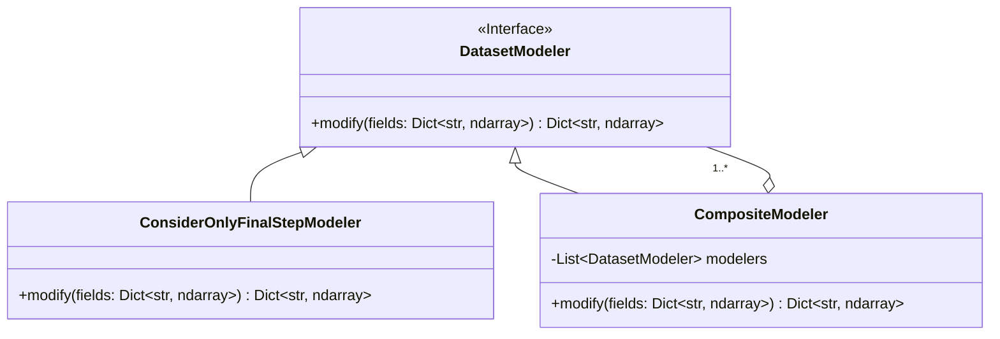

# Data Architecture: `DatasetEngine`

This document details the architectural design and technical specification of the dataset preprocessing subsystem, structured around the **`DatasetEngine`** pipeline.

---

## 1. Architectural Philosophy: Strategy & Pipeline Pattern

Rather than using inheritance-heavy hierarchies, the architecture adopts **Composition over Inheritance** (the Strategy / Pipeline Pattern).

The **`DatasetEngine`** acts as an orchestrator coordinating **decoupled, single-responsibility components**:

```mermaid
flowchart LR
    RAW["Raw Simulation File<br>(e.g. .mat)"]
    --> |"1. FormatImporter"| M1["In-Memory Dict<br>(raw arrays)"]
    --> |"2. PhysicalSetup"| M2["Physical Fields Dict<br>(5D, 4D, 3D, 1D tensors)"]
    --> |"3. DatasetModeler"| M3["Task-Modeled Fields<br>(e.g. final step, downsampled)"]
    --> |"4. DatasetSplitter"| M4["Dataset Partitions<br>(train, val, test)"]
    --> |"5. DatasetNormalizer"| M5["Statistical Data<br>(mean, std from train)"]
    --> |"6. FormatExporter"| OUT["Processed Disk Files<br>(train.npz, val.npz, statistical_data.json)"]
```



### Core Design Advantages
* **Decoupled Responsibilities:** Each stage has a single job with clear, type-hinted inputs and outputs.
* **Separation of Physical Reality from Task Formulation:** `PhysicalSetup` produces the faithful physical representation of the simulation (ground truth across all coordinates and time steps). Problem-specific modifications (such as predicting only the final steady state, subsampling the mesh, or selecting specific channels) are delegated to **`DatasetModeler`**.
* **Chaining Multiple Modifications via the Composite Pattern:** To avoid bloating `DatasetEngine` with multiple modifier slots, the system uses **`CompositeModeler`**. It implements the `DatasetModeler` interface while wrapping a list of child modelers, executing them sequentially. The engine interacts with one uniform interface whether zero, one, or ten modifications are performed.
* **Extensibility:** Supporting a new simulation format (e.g., HDF5 or VTK) only requires a new `FormatImporter`, without changing physical cleaning, modeling, splitting, normalizing, or exporting logic.
* **Zero Data Leakage:** `DatasetNormalizer` calculates scaling moments strictly from `partitions["train"]`, ensuring validation and test partitions remain completely unobserved during normalization.

---

## 2. UML Class Diagram

```mermaid
classDiagram
    direction TB

    %% Composition: Engine coordinates pipeline components
    DatasetEngine *-- FormatImporter
    DatasetEngine *-- PhysicalSetup
    DatasetEngine *-- "0..1" DatasetModeler
    DatasetEngine *-- DatasetSplitter
    DatasetEngine *-- DatasetNormalizer
    DatasetEngine *-- FormatExporter

    %% Inheritance / Implementations of specific strategies
    FormatImporter <|-- MatlabImporter
    PhysicalSetup <|-- PlasticitySetup
    FormatExporter <|-- NpzExporter
    DatasetModeler <|-- ConsiderOnlyFinalStepModeler
    DatasetModeler <|-- CompositeModeler
    CompositeModeler o-- "1..*" DatasetModeler

    class DatasetEngine {
        +FormatImporter importer
        +PhysicalSetup cleaner
        +Optional~DatasetModeler~ modeler
        +DatasetSplitter splitter
        +DatasetNormalizer normalizer
        +FormatExporter exporter
        +process(raw_path: Path, output_dir: Path, split_ratios: tuple~int, int, int~) Dict~str, Path~
    }

    class FormatImporter {
        <<Interface>>
        +load(path: Path) Dict~str, ndarray~
    }

    class MatlabImporter {
        +load(path: Path) Dict~str, ndarray~
    }

    class PhysicalSetup {
        <<Interface>>
        +setup(raw_dict: Dict~str, ndarray~) Dict~str, ndarray~
    }

    class PlasticitySetup {
        +setup(raw_dict: Dict~str, ndarray~) Dict~str, ndarray~
    }

    class DatasetModeler {
        <<Interface>>
        +modify(fields: Dict~str, ndarray~) Dict~str, ndarray~
    }

    class ConsiderOnlyFinalStepModeler {
        +modify(fields: Dict~str, ndarray~) Dict~str, ndarray~
    }

    class CompositeModeler {
        -List~DatasetModeler~ modelers
        +modify(fields: Dict~str, ndarray~) Dict~str, ndarray~
    }

    class DatasetSplitter {
        +split(arrays: Dict~str, ndarray~, train_n: int, val_n: int, test_n: int) Dict~str, Dict~
    }

    class DatasetNormalizer {
        +compute_statistical_data(train_arrays: Dict~str, ndarray~) Dict~str, Dict~
    }

    class FormatExporter {
        <<Interface>>
        +save(splits: Dict~str, Dict~, statisticalData: Dict~str, Dict~, output_dir: Path) List~Path~
    }

    class NpzExporter {
        +save(splits: Dict~str, Dict~, statisticalData: Dict~str, Dict~, output_dir: Path) List~Path~
    }
```



### Key UML Structural Notes
1. **The Aggregation Diamond (`CompositeModeler o-- "1..*" DatasetModeler`):**
   - In standard Object-Oriented Design (the Gang of Four Composite Pattern), the hollow aggregation diamond points to the abstract interface **`DatasetModeler`**, NOT directly to concrete leaves like `ConsiderOnlyFinalStepModeler`.
   - **Rationale (Dependency Inversion & Polymorphism):** If `CompositeModeler` pointed directly to `ConsiderOnlyFinalStepModeler`, it would be tightly coupled to only that specific modification. By aggregating the abstract `DatasetModeler`, `CompositeModeler` can hold **any** class that implements `DatasetModeler` (including `ConsiderOnlyFinalStepModeler`, mesh subsamplers, noise injectors, or other composites) without needing any code modifications.
   - *Note on Diagram Layout:* In wide Mermaid class diagrams, drawing the aggregation edge back to the interface can cause the auto-layout engine to route around adjacent components. For an isolated, artifact-free diagram of the Composite Pattern alone, see the focused diagram in [Section 3.3](#3-datasetmodeler-task-formulation--modification).
2. **Decoupling Between `DatasetModeler` and `DatasetSplitter`:**
   - There is **no arrow, connection, or dependency** between `DatasetModeler` and `DatasetSplitter` in the class diagram.
   - `DatasetModeler` transforms tensors in memory and knows nothing about dataset partitioning.
   - `DatasetSplitter` partitions arrays along samples and knows nothing about what spatial/temporal modeling was performed.
   - Their interaction is strictly temporal, orchestrated linearly by `DatasetEngine.process()`.

---

## 3. Pipeline Components & Specifications

### 1. `FormatImporter` (Ingestion)
* **Contract:** `load(path: Path) -> Dict[str, np.ndarray]`
* **Purpose:** Reads solver-specific raw files from disk into Python memory as a dictionary of raw NumPy arrays.
* **Implementation (`MatlabImporter`):** Reads ABAQUS MATLAB `.mat` files (e.g., `plas_N987_T20.mat`) using `scipy.io.loadmat` and returns the raw `'input'` and `'output'` keys.

### 2. `PhysicalSetup` (Transformation & Structuring)
* **Contract:** `setup(raw_dict: Dict[str, np.ndarray]) -> Dict[str, np.ndarray]`
* **Purpose:** Cleans coordinate anomalies and unpacks opaque solver matrices into named physical tensors.
* **Implementation (`PlasticitySetup`):**
  - Aligns non-monotonic horizontal coordinate axes (monotonic ordering from $-49.65$ to $+0.35$ mm).
  - Isolates initial geometry $t=0$, boundary die contour, deformed coordinate paths, and displacement vectors across all time increments.

### 3. `DatasetModeler` (Task Formulation & Modification)
* **Contract:** `modify(fields: Dict[str, np.ndarray]) -> Dict[str, np.ndarray]`
* **Purpose:** Tailors the physical tensors for specific machine learning problem formulations (e.g., static vs. dynamic, mesh resolution, temporal slicing).
* **Composite Pattern Architecture:**
  - `DatasetEngine` only receives **one** `DatasetModeler` instance (`modeler: Optional[DatasetModeler] = None`).
  - When multiple transformations are desired, they are wrapped inside `CompositeModeler([mod1, mod2, ...])`.
  - Because `CompositeModeler` implements `DatasetModeler`, `DatasetEngine` remains 100% agnostic to whether it is running 0, 1, or $N$ transformations.



* **Implementations:**
  - **`ConsiderOnlyFinalStepModeler`:** Slices coordinates and displacements to retain only the final timestep $t_{\text{final}} = t_{-1}$, converting 5D trajectory tensors `(N, nx, ny, nt, 2)` into 4D static prediction tensors `(N, nx, ny, 2)`, and removes `time_steps` to produce a purely static dataset formulation.
  - **`CompositeModeler`:** Holds an ordered collection of `DatasetModeler` objects and executes their `.modify()` methods in sequence:
    $$\text{fields}_{k} = \text{modeler}_k.\text{modify}(\text{fields}_{k-1})$$

### 4. `DatasetSplitter` (Partitioning)
* **Contract:** `split(arrays: Dict[str, np.ndarray], train_n: int, val_n: int, test_n: int) -> Dict[str, Dict[str, np.ndarray]]`
* **Purpose:** Deterministically partitions the dataset along simulation samples (e.g. 900 train, 7 val, 80 test).
* **Guarantees:** Never splits across time increments of the same simulation run. Broadcasts shared invariant variables (like `time_steps`) across all partitions.

### 5. `DatasetNormalizer` (Statistical Scaling)
* **Contract:** `compute_statistical_data(train_arrays: Dict[str, np.ndarray]) -> Dict[str, Dict[str, float]]`
* **Purpose:** Computes the mathematical moments required to normalize data for neural networks:
  $$\mathbf{y}_{\text{norm}} = \frac{\mathbf{y} - \boldsymbol{\mu}_{\text{train}}}{\boldsymbol{\sigma}_{\text{train}}}$$
* **Data Leakage Guarantee:** Strictly computes mean ($\boldsymbol{\mu}$), standard deviation ($\boldsymbol{\sigma}$), min, and max **only from `splits["train"]`**, computed directly on the modeled tensor shapes.

### 6. `FormatExporter` (Serialization & Verification)
* **Contract:** `save(splits: Dict[str, Dict], statisticalData: Dict[str, Dict], output_dir: Path) -> List[Path]`
* **Purpose:** Writes partitioned arrays and scaling parameters to disk in high-performance storage formats.
* **Implementation (`NpzExporter`):**
  - Exports `train.npz`, `val.npz`, `test.npz` (NumPy compressed archives).
  - Exports `statistical_data.json` for model denormalization during inference.
  - Verifies written files: asserts sizes $> 0$ and confirms zero `NaN` or `Inf` values.

---

## 4. In-Memory Data Structure & Tensor Shapes

When `splits` enters `FormatExporter`, it is a nested Python dictionary holding the entire partitioned dataset in RAM:

```python
splits: Dict[str, Dict[str, np.ndarray]] = {
    "train": { ... },  # 900 simulations
    "val":   { ... },  # 7 simulations
    "test":  { ... },  # 80 simulations
}
```

### Full Temporal Pipeline (No Modeler / Identity)

| Key | Tensor Shape (`train`) | Tensor Shape (`val`) | Tensor Shape (`test`) | Dtype | Dims | Physical Meaning |
| :--- | :--- | :--- | :--- | :--- | :--- | :--- |
| **`target_all`** | `(900, 101, 31, 20, 4)` | `(7, 101, 31, 20, 4)` | `(80, 101, 31, 20, 4)` | `float64` | **5D** | **All 4 solution channels** $[X, Y, u_x, u_y]$ across time. |
| **`coords`** | `(900, 101, 31, 20, 2)` | `(7, 101, 31, 20, 2)` | `(80, 101, 31, 20, 2)` | `float64` | **5D** | Deformed coordinates $(X, Y)$ across mesh width, height, and time. |
| **`displacements`** | `(900, 101, 31, 20, 2)` | `(7, 101, 31, 20, 2)` | `(80, 101, 31, 20, 2)` | `float64` | **5D** | Displacements $(u_x, u_y)$ across mesh width, height, and time. |
| **`coords_initial`**| `(900, 101, 31, 2)` | `(7, 101, 31, 2)` | `(80, 101, 31, 2)` | `float64` | **4D** | Reference undeformed mesh $(X_0, Y_0)$ at $t = 0$ (Input). |
| **`die_boundary`**  | `(900, 101, 2)` | `(7, 101, 2)` | `(80, 101, 2)` | `float32` | **3D** | Top impacting die shape $[x, S_d(x)]$ (Input). |
| **`time_steps`**    | `(20,)` | `(20,)` | `(20,)` | `float32` | **1D** | Shared normalized physical timestamps $t^* \in [0, 1]$. |

### Modeled Pipeline (with `ConsiderOnlyFinalStepModeler`)

When `ConsiderOnlyFinalStepModeler` is applied, each simulation run collapses from a 20-step sequence into **a single static result per sample** at $t_{\text{final}} = t_{-1}$, and `time_steps` is eliminated:

| Key | Tensor Shape (`train`) | Tensor Shape (`val`) | Tensor Shape (`test`) | Dtype | Dims | Physical Meaning & Role |
| :--- | :--- | :--- | :--- | :--- | :--- | :--- |
| **`target_all`** | `(900, 101, 31, 4)` | `(7, 101, 31, 4)` | `(80, 101, 31, 4)` | `float64` | **4D** | **Complete Solution:** Contains all 4 channels $[X, Y, u_x, u_y]$ at $t = t_{-1}$. |
| **`coords`** | `(900, 101, 31, 2)` | `(7, 101, 31, 2)` | `(80, 101, 31, 2)` | `float64` | **4D** | **Target View:** Final deformed mesh coordinates $(X, Y)$ at $t = t_{-1}$. |
| **`displacements`** | `(900, 101, 31, 2)` | `(7, 101, 31, 2)` | `(80, 101, 31, 2)` | `float64` | **4D** | **Target View:** Final displacement field $(u_x, u_y)$ at $t = t_{-1}$. |
| **`coords_initial`**| `(900, 101, 31, 2)` | `(7, 101, 31, 2)` | `(80, 101, 31, 2)` | `float64` | **4D** | **Model Input:** Undeformed reference mesh $(X_0, Y_0)$ at $t = 0$. |
| **`die_boundary`**  | `(900, 101, 2)` | `(7, 101, 2)` | `(80, 101, 2)` | `float32` | **3D** | **Model Input:** Top impacting die shape $[x, S_d(x)]$. |

### Relationship Between `target_all`, `coords`, and `displacements`

Notice that **`target_all` contains the complete output simulation state**. It unifies `coords` and `displacements` along its final channel dimension:

$$\mathbf{target\_all}[..., 0:2] \equiv \mathbf{coords} \quad (X, Y)$$
$$\mathbf{target\_all}[..., 2:4] \equiv \mathbf{displacements} \quad (u_x, u_y)$$

* **Input Features for Surrogate Models:** `die_boundary` (boundary condition driving the deformation) and `coords_initial` (the reference geometry).
* **Target Labels for Surrogate Models:**
  - A model training to predict the entire physical state directly uses **`target_all`** `(N, nx, ny, 4)`.
  - A model specifically formulated to predict displacements uses **`displacements`** `(N, nx, ny, 2)`.
  - A model formulated to predict deformed coordinates uses **`coords`** `(N, nx, ny, 2)`.

All these keys are persisted together by `FormatExporter` into the exported `.npz` files (`train.npz`, `val.npz`, `test.npz`) so downstream PyTorch datasets can flexibly select whichever formulation they require without re-running preprocessing.

---

## 5. Orchestration Workflow

The execution flow of [`DatasetEngine.process()`](file:///home/arturobaltanas/University/Guided%20Research/doc/arquitecture/data_architecture.md#L48-L56) coordinates the strategies linearly:

```python
from abc import ABC, abstractmethod
from pathlib import Path
from typing import Dict, List, Optional, Sequence, Tuple
import numpy as np


class DatasetModeler(ABC):
    """Abstract interface for task-specific dataset modifications."""

    @abstractmethod
    def modify(self, fields: Dict[str, np.ndarray]) -> Dict[str, np.ndarray]:
        """Apply modification/transformation to physical fields."""
        pass


class ConsiderOnlyFinalStepModeler(DatasetModeler):
    """Retains only the final time step of simulation trajectories."""

    def modify(self, fields: Dict[str, np.ndarray]) -> Dict[str, np.ndarray]:
        modified = dict(fields)
        if "coords" in modified and modified["coords"].ndim == 5:
            modified["coords"] = modified["coords"][:, :, :, -1, :]
        if "displacements" in modified and modified["displacements"].ndim == 5:
            modified["displacements"] = modified["displacements"][:, :, :, -1, :]
        if "target_all" in modified and modified["target_all"].ndim == 5:
            modified["target_all"] = modified["target_all"][:, :, :, -1, :]
        if "time_steps" in modified:
            del modified["time_steps"]
        return modified


class CompositeModeler(DatasetModeler):
    """Chains multiple DatasetModeler modifications in sequence (Composite Pattern)."""

    def __init__(self, modelers: Sequence[DatasetModeler]) -> None:
        self.modelers = list(modelers)

    def modify(self, fields: Dict[str, np.ndarray]) -> Dict[str, np.ndarray]:
        current_fields = fields
        for modeler in self.modelers:
            current_fields = modeler.modify(current_fields)
        return current_fields


class DatasetEngine:
    def __init__(
        self,
        importer: FormatImporter,
        cleaner: PhysicalSetup,
        splitter: DatasetSplitter,
        normalizer: DatasetNormalizer,
        exporter: FormatExporter,
        modeler: Optional[DatasetModeler] = None,
    ) -> None:
        self.importer = importer
        self.cleaner = cleaner
        self.splitter = splitter
        self.normalizer = normalizer
        self.exporter = exporter
        self.modeler = modeler

    def process(
        self,
        raw_path: Path,
        output_dir: Path,
        split_ratios: Tuple[int, int, int],
    ) -> Dict[str, Path]:
        train_n, val_n, test_n = split_ratios

        # 1. Ingest raw format into memory
        raw_data = self.importer.load(raw_path)

        # 2. Extract and structure physical tensors
        fields = self.cleaner.setup(raw_data)

        # 3. Apply dataset modification (single modeler or CompositeModeler chain)
        if self.modeler is not None:
            fields = self.modeler.modify(fields)

        # 4. Partition into Train / Validation / Test
        splits = self.splitter.split(fields, train_n, val_n, test_n)

        # 5. Compute normalization moments (zero data leakage)
        statistical_data = self.normalizer.compute_statistical_data(splits["train"])

        # 6. Export partitions and scaling parameters to disk
        saved_paths: List[Path] = self.exporter.save(splits, statistical_data, output_dir)
        return {p.stem: p for p in saved_paths}
```

---

## 6. Source Code Organization

The classes and interfaces specified in this document are organized in the codebase as follows:

| Component Role | Classes / Interfaces | File Location |
| :--- | :--- | :--- |
| **Interfaces** | `FormatImporter`, `PhysicalSetup`, `DatasetModeler`, `FormatExporter` | [`src/data/interfaces.py`](file:///home/arturobaltanas/University/Guided%20Research/src/data/interfaces.py) |
| **Ingestion** | `MatlabImporter` | [`src/data/importers.py`](file:///home/arturobaltanas/University/Guided%20Research/src/data/importers.py) |
| **Transformation** | `PlasticitySetup` | [`src/data/setups.py`](file:///home/arturobaltanas/University/Guided%20Research/src/data/setups.py) |
| **Task Modeling** | `ConsiderOnlyFinalStepModeler`, `CompositeModeler` | [`src/data/modelers.py`](file:///home/arturobaltanas/University/Guided%20Research/src/data/modelers.py) |
| **Partitioning** | `DatasetSplitter` | [`src/data/splitter.py`](file:///home/arturobaltanas/University/Guided%20Research/src/data/splitter.py) |
| **Normalization** | `DatasetNormalizer` | [`src/data/normalizer.py`](file:///home/arturobaltanas/University/Guided%20Research/src/data/normalizer.py) |
| **Serialization** | `NpzExporter` | [`src/data/exporters.py`](file:///home/arturobaltanas/University/Guided%20Research/src/data/exporters.py) |
| **Orchestration** | `DatasetEngine` | [`src/data/engine.py`](file:///home/arturobaltanas/University/Guided%20Research/src/data/engine.py) |
| **Package Exports** | All public interfaces and concrete classes | [`src/data/__init__.py`](file:///home/arturobaltanas/University/Guided%20Research/src/data/__init__.py) |
| **CLI Runner** | End-to-end preprocessing script (`--final_step_only`) | [`scripts/preprocess_dataset.py`](file:///home/arturobaltanas/University/Guided%20Research/scripts/preprocess_dataset.py) |
| **Test Suite** | Unit and integration tests | [`tests/test_dataset_engine.py`](file:///home/arturobaltanas/University/Guided%20Research/tests/test_dataset_engine.py) |
