# Evaluation Architecture: `EvaluationEngine`

This document details the architectural design, component responsibilities, and technical specifications of the post-training scientific evaluation and comparative benchmarking subsystem, centered around the **`EvaluationEngine`** orchestrator.

---

## 1. High-Level Executive Summary: The 9-Stage Framework

Within the overall research framework, the **`EvaluationEngine`** represents the final scientific verification stage that converts trained checkpoints into publication-ready comparative benchmarks:

1. **`DatasetEngine`:** Preprocesses raw simulation files (e.g., ABAQUS `.mat`) and saves clean, partitioned NumPy archives to disk (`train.npz`, `val.npz`, `test.npz`, `statistical_data.json`).
2. **`BatchLoader`:** Reads simulation samples from disk partitions and prepares them into model-specific PyTorch tensor batches (`loadDataset`).
3. **`ModelWrapper`:** Houses and instantiates the deep learning model (e.g., SMART, uPDEt), executes the forward pass, and standardizes input/output tensor shapes.
4. **`LossEngine`:** Measures surrogate prediction errors against ground-truth simulation physics (e.g., Relative $L_2$, Mean Squared Error, boundary penalties).
5. **`Optimizer`:** Computes parameter gradients, applies gradient clipping, updates neural network weights, and steps the learning rate schedule.
6. **`CheckpointHandler`:** Persists model weights, optimizer states, and epoch metadata to disk whenever validation metrics achieve a new best.
7. **`TelemetryLogger` (`CliProgressMonitor`):** Renders real-time terminal progress bars, percentage completion, hardware utilization, and estimated time of arrival (ETA).
8. **`TrainingEngine`:** The central orchestrator that coordinates the outer epoch loop and inner batch loops, connecting all training components seamlessly.
9. **`EvaluationEngine`:** Post-training validator that evaluates checkpoints on unobserved test data in real physical units (millimeters), verifies solid mechanics contact adherence, measures inference speed, and exports publication artifacts.

---

## 2. Core Intuition: What Does `EvaluationEngine` Really Do?

If the **`TrainingEngine`** is the **gymnasium** where the model trains and learns...  
the **`EvaluationEngine`** is the **final university examination** that determines whether the model is accurate, physically valid, and ready for publication or industrial deployment.

### The 5 Questions Training Loss Cannot Answer
When training finishes, all you have in the terminal is an abstract, dimensionless number:
```text
Val Loss: 0.0421
```
This number has no physical units (it was calculated on normalized data scaled between $0$ and $1$). If you present a validation loss of $0.042$ to an engineering supervisor or research conference, they will immediately ask five critical questions that the training loop **cannot answer**:

1. **Real Physical Accuracy:** *“How many real millimeters does the predicted workpiece deviate compared to the ABAQUS ground truth?”*
2. **Worst-Case Tolerance:** *“What was the single worst node error ($L_\infty$) across the entire workpiece? Did it fail by $0.1$ mm or by $4.0$ mm?”*
3. **Contact Zone Fidelity:** *“How much error occurs at the critical contact boundary where the die strikes the metal versus the interior continuum?”*
4. **Physical Feasibility:** *“Does the prediction obey solid mechanics contact laws, or does the metal magically penetrate inside the solid steel die?”*
5. **Surrogate Speedup:** *“How fast is inference compared to the ~2 minutes ABAQUS takes? Exactly how many thousand times faster is the surrogate?”*

The **`EvaluationEngine`** exists specifically to answer these five questions.

---

## 3. The 5-Step Evaluation Journey

Once training is complete and you have your saved checkpoint (`best_model.pt`), running `EvaluationEngine.evaluate()` executes a clear 5-step pipeline:

```
[best_model.pt] + [test.npz (80 unobserved test simulations)]
       │
       ▼
 1. Administer the Exam (InferenceRunner)
    Runs deterministic forward passes on the 80 test simulations the model has NEVER seen.
       │
       ▼
 2. Translate Back to Real Millimeters (Denormalizer)
    Uses 'statistical_data.json' to invert scaling:
    u_phys = u_norm ⊙ σ_train + μ_train  [mm]
    Converts unitless outputs into real millimeter displacements (e.g., ux = 2.1 mm, uy = -5.4 mm).
       │
       ▼
 3. Compute Scientific Benchmark Metrics (PhysicalMetricsCalculator)
    • Mean Relative L2 Error: Global percentage deviation (e.g., 3.2% global error).
    • Peak Pointwise Error (L_inf): Worst-case node deviation (e.g., "worst point deviated by 0.34 mm").
    • Surface vs. Volume Error: Separates contact boundary accuracy from interior continuum flow.
    • Sobolev H1 Semi-Norm: Evaluates finite-difference strain gradients (checks if internal stresses are smooth).
       │
       ▼
 4. Physics & Contact Inspector (FeasibilityValidator)
    Verifies that the metal workpiece does NOT penetrate the rigid steel punch:
    Δ_penetration(x) = max(0, y_surf(x) - S_d(x))
    Detects and flags any unphysical boundary penetration violations.
       │
       ▼
 5. Hardware Profiler & Report Generator (BenchmarkProfiler + ReportExporter)
    • Measures GPU inference latency: "Takes 4.8 milliseconds per simulation on GPU".
    • Calculates speedup vs. FEM: "ABAQUS took 120s ──> Surrogate is 25,000x faster".
    • Automatically writes 'evaluation_summary.md', JSON records, and error contour plots
      ready to copy-paste directly into your research paper or thesis.
```

---

## 4. Why Must It Be a Decoupled Engine?

1. **Training Speed Protection:**  
   Calculating spatial finite differences, denormalizing full 3D/4D arrays, checking non-penetration geometry, and running synchronized CUDA GPU latency warm-ups after every training epoch would make training 10 times slower.
2. **Absolute Scientific Fairness Across Models (Milestone 3):**  
   When comparing **SMART**, **uPDEt**, and **Geo-FNO baselines**, all models are fed into the **exact same `EvaluationEngine`**. No model gets an unfair advantage: all are tested on the exact same 80 unseen test cases, using the exact same millimeter formulas, feasibility checks, and profiling timers.

---

## 5. UML Class Diagram

```mermaid
classDiagram
    direction TB

    %% Composition: EvaluationEngine coordinates analysis strategies
    EvaluationEngine *-- InferenceRunner
    EvaluationEngine *-- Denormalizer
    EvaluationEngine *-- PhysicalMetricsCalculator
    EvaluationEngine *-- FeasibilityValidator
    EvaluationEngine *-- BenchmarkProfiler
    EvaluationEngine *-- ReportExporter

    %% Metric Calculator Implementations
    PhysicalMetricsCalculator <|-- PlasticityMetricsCalculator

    %% Feasibility Validator Implementations
    FeasibilityValidator <|-- DiePenetrationValidator

    %% Exporter Implementations
    ReportExporter <|-- MarkdownReportExporter
    ReportExporter <|-- JsonReportExporter

    class EvaluationEngine {
        +InferenceRunner runner
        +Denormalizer denormalizer
        +PhysicalMetricsCalculator metrics_calc
        +FeasibilityValidator validator
        +BenchmarkProfiler profiler
        +ReportExporter exporter
        +evaluate(model: Module, checkpoint_path: Path, test_loader: DataLoader, stats_path: Path, output_dir: Path, device: torch.device, fem_reference_time_s: float) Dict~str, Any~
    }

    class InferenceRunner {
        +predict(model: Module, dataloader: DataLoader, device: torch.device) Dict~str, ndarray~
    }

    class Denormalizer {
        +denormalize(pred_norm: Dict~str, ndarray~, target_norm: Dict~str, ndarray~, stats: Dict~str, Any~) Tuple~Dict, Dict~
    }

    class PhysicalMetricsCalculator {
        <<Interface>>
        +compute_metrics(pred_phys: Dict~str, ndarray~, target_phys: Dict~str, ndarray~, initial_mesh: ndarray) Dict~str, float~
    }

    class PlasticityMetricsCalculator {
        +compute_relative_l2(pred: ndarray, target: ndarray) float
        +compute_l_infinity(pred: ndarray, target: ndarray) float
        +compute_sobolev_h1(pred: ndarray, target: ndarray) float
        +compute_surface_vs_volume(pred: ndarray, target: ndarray) Dict~str, float~
    }

    class FeasibilityValidator {
        <<Interface>>
        +check_constraints(pred_coords: ndarray, boundary_constraints: ndarray) Dict~str, float~
    }

    class DiePenetrationValidator {
        +check_constraints(pred_coords: ndarray, die_boundary: ndarray) Dict~str, float~
    }

    class BenchmarkProfiler {
        +profile_inference(model: Module, sample_batch: Dict~str, Tensor~, device: torch.device, fem_reference_time_s: float) Dict~str, float~
    }

    class ReportExporter {
        <<Interface>>
        +export(summary: Dict~str, Any~, output_dir: Path) Dict~str, Path~
    }
```



---

## 6. In-Depth Component Specifications & Responsibilities

### 6.1 `InferenceRunner` (Deterministic Execution)
* **Contract:** `predict(model: nn.Module, dataloader: DataLoader, device: torch.device) -> Dict[str, np.ndarray]`
* **Purpose:** Runs batch-wise inference across the test partition under strict evaluation conditions (`model.eval()`, `torch.no_grad()`).
* **Output:** Concatenates all batches across the test set into complete NumPy arrays containing predictions for all test simulations.

### 6.2 `Denormalizer` (Physical Rescaling)
* **Contract:** `denormalize(pred_norm: Dict[str, np.ndarray], target_norm: Dict[str, np.ndarray], stats: Dict[str, Any]) -> Tuple[Dict[str, np.ndarray], Dict[str, np.ndarray]]`
* **Purpose:** Inverts the normalization performed by `DatasetNormalizer`:
  $$\mathbf{u}_{\text{phys}} = \mathbf{u}_{\text{norm}} \odot \boldsymbol{\sigma}_{\text{train}} + \boldsymbol{\mu}_{\text{train}} \quad [\text{mm}]$$
  $$\mathbf{x}_{\text{phys}} = \mathbf{X}_{0, \text{phys}} + \mathbf{u}_{\text{phys}} \quad [\text{mm}]$$
* **Output:** Returns true physical coordinates and displacements in millimeters, enabling direct comparison with physical experiments and FEM benchmarks.

### 6.3 `PhysicalMetricsCalculator` (Scientific Error Quantification)
* **Contract:** `compute_metrics(pred_phys: Dict[str, np.ndarray], target_phys: Dict[str, np.ndarray], initial_mesh: np.ndarray) -> Dict[str, float]`
* **Purpose:** Calculates scientific error metrics on denormalized arrays:
  1. **Mean Relative $L_2$ Error (MRE):**
     $$\text{Rel } L_2 = \frac{1}{N_{\text{test}}} \sum_{i=1}^{N_{\text{test}}} \frac{\|\hat{\mathbf{u}}_i - \mathbf{u}_i\|_F}{\|\mathbf{u}_i\|_F}$$
  2. **Maximum Pointwise Error ($L_\infty$):**
     $$L_\infty = \max_{i, j, k} |\hat{\mathbf{u}}_{i, j, k} - \mathbf{u}_{i, j, k}| \quad [\text{mm}]$$
  3. **Surface vs. Volume Partitioned Error:**
     - `surface_rel_l2`: Relative error isolated strictly on the upper contact boundary nodes ($y \approx 15.0$ mm).
     - `volume_rel_l2`: Relative error across internal continuum workpiece nodes.
  4. **Sobolev $H^1$ Semi-Norm Error (Deformation Gradient / Strain Proxy):**
     Using central finite differences along the curvilinear mesh indices $(\xi, \eta)$:
     $$\mathbf{F} \approx \nabla_{\boldsymbol{\xi}} \mathbf{u}, \quad \text{Rel } H^1 = \frac{\|\nabla \hat{\mathbf{u}} - \nabla \mathbf{u}\|_F}{\|\nabla \mathbf{u}\|_F + \epsilon}$$

### 6.4 `FeasibilityValidator` (`DiePenetrationValidator`)
* **Contract:** `check_constraints(pred_coords: np.ndarray, boundary_constraints: np.ndarray) -> Dict[str, float]`
* **Purpose:** Verifies that the deformed metal workpiece does not violate physical contact boundary conditions by penetrating the rigid upper die $S_d(x)$:
  $$\Delta_{\text{penetration}}(x) = \max\left(0, y_{\text{surf}}(x) - S_d(x)\right)$$
* **Computed Outputs:**
  - `max_die_penetration_mm`: Maximum penetration depth into the die (mm).
  - `mean_die_penetration_mm`: Average penetration across violating boundary nodes.
  - `penetration_violation_rate`: Percentage of surface nodes violating the non-penetration condition.

### 6.5 `BenchmarkProfiler` (Hardware & Efficiency Telemetry)
* **Contract:** `profile_inference(model: nn.Module, sample_batch: Dict[str, torch.Tensor], device: torch.device, fem_reference_time_s: float = 120.0) -> Dict[str, float]`
* **Purpose:** Benchmarks computational efficiency under standardized hardware conditions:
  - **Inference Latency per Sample:** Milliseconds per simulation run (measured using synchronized CUDA events with initial warm-up cycles).
  - **Peak VRAM Allocation:** Maximum GPU memory required during batch inference (MB).
  - **Parameter Complexity:** Total and trainable parameter counts.
  - **Surrogate Speedup Factor:**
    $$\text{Speedup} = \frac{t_{\text{Abaqus FEM}}}{t_{\text{Surrogate Inference}}}$$
    (e.g., $120.0\text{ s} / 0.0048\text{ s} = 25,000\times$ speedup).

### 6.6 `ReportExporter` (Artifact Generation)
* **Contract:** `export(summary: Dict[str, Any], output_dir: Path) -> Dict[str, Path]`
* **Purpose:** Automatically generates structured, publication-grade outputs:
  - `evaluation_summary.md`: Markdown table summarizing physical errors, feasibility checks, and speedups.
  - `evaluation_metrics.json`: Machine-readable JSON summary for cross-model comparative studies (Milestone 3).
  - `error_distribution_plots/`: Contour figures visualizing absolute error fields ($|\hat{\mathbf{u}} - \mathbf{u}|$) across the workpiece.

---

## 7. Standardized Benchmark Report Format (Mockup)

When `EvaluationEngine.evaluate()` finishes, it automatically produces `evaluation_summary.md` in the results directory:

```markdown
# Surrogate Benchmark Report: SMART Baseline
**Checkpoint:** `results/checkpoints/best_model.pt` | **Test Dataset:** `test.npz` (80 unobserved simulations)

### 1. Physical Accuracy Metrics (Real Physical Units: mm)
| Metric | Value | Reference Standard | Assessment |
| :--- | :--- | :--- | :--- |
| **Overall Relative L2 Error** | **3.24%** | < 5.0% | Excellent |
| **Surface Contact L2 Error** | **4.12%** | < 6.0% | Strong Contact Adherence |
| **Volume Interior L2 Error** | **3.08%** | < 5.0% | Accurate Continuum Flow |
| **Maximum Pointwise Error (L_inf)** | **0.34 mm** | Peak disp: 6.51 mm | 5.2% Peak Deviation |
| **Sobolev H1 Semi-Norm Error** | **6.85%** | < 10.0% | Consistent Strain Gradients |

### 2. Physical Feasibility (Die Non-Penetration)
| Metric | Value | Constraint Threshold | Status |
| :--- | :--- | :--- | :--- |
| **Max Die Penetration Depth** | **0.02 mm** | < 0.05 mm | PASS |
| **Mean Die Penetration** | **0.004 mm** | < 0.01 mm | PASS |
| **Contact Violation Rate** | **1.2%** of nodes | < 5.0% | PASS |

### 3. Computational Performance vs. Numerical Solver
| Hardware / Execution Metric | Value |
| :--- | :--- |
| **Hardware Device** | NVIDIA A100-SXM4-80GB |
| **Inference Latency per Sample** | **4.82 ms** |
| **Peak GPU Memory Allocation** | **1,248 MB** |
| **Trainable Parameters** | **7,937,468** |
| **Abaqus FEM Solver Runtime** | ~120.0 seconds / simulation |
| **Surrogate Speedup Factor** | **24,896x Faster** |
```

---

## 8. Complete Orchestration Workflow

The Python implementation below illustrates the exact execution flow of [`EvaluationEngine`](file:///home/arturobaltanas/University/Guided%20Research/src/evaluation/engine.py):

```python
"""Orchestrator for surrogate physical evaluation, feasibility checks, and benchmarking."""

import json
from pathlib import Path
from typing import Any, Dict, Optional
import numpy as np
import torch
import torch.nn as nn
from torch.utils.data import DataLoader

from src.evaluation.interfaces import (
    BenchmarkProfiler,
    Denormalizer,
    FeasibilityValidator,
    InferenceRunner,
    PhysicalMetricsCalculator,
    ReportExporter,
)


class EvaluationEngine:
    """Coordinates post-training physical evaluation, validation, and benchmarking.

    Parameters
    ----------
    runner : InferenceRunner
        Batch prediction executor.
    denormalizer : Denormalizer
        Statistical rescaling strategy.
    metrics_calc : PhysicalMetricsCalculator
        Scientific PDE error metrics calculator.
    validator : FeasibilityValidator
        Physical boundary condition constraint validator.
    profiler : BenchmarkProfiler
        Inference latency, memory, and throughput profiler.
    exporter : ReportExporter
        Report and artifact generation strategy.
    """

    def __init__(
        self,
        runner: InferenceRunner,
        denormalizer: Denormalizer,
        metrics_calc: PhysicalMetricsCalculator,
        validator: FeasibilityValidator,
        profiler: BenchmarkProfiler,
        exporter: ReportExporter,
    ) -> None:
        self.runner = runner
        self.denormalizer = denormalizer
        self.metrics_calc = metrics_calc
        self.validator = validator
        self.profiler = profiler
        self.exporter = exporter

    def evaluate(
        self,
        model: nn.Module,
        checkpoint_path: Path,
        test_loader: DataLoader,
        stats_path: Path,
        output_dir: Path,
        device: torch.device,
        fem_reference_time_s: float = 120.0,
    ) -> Dict[str, Any]:
        """Execute full scientific benchmark evaluation.

        Parameters
        ----------
        model : nn.Module
            Instantiated surrogate model.
        checkpoint_path : Path
            Path to the saved checkpoint file.
        test_loader : DataLoader
            DataLoader wrapping test.npz.
        stats_path : Path
            Path to statistical_data.json.
        output_dir : Path
            Directory where evaluation reports and plots will be written.
        device : torch.device
            Evaluation hardware device.
        fem_reference_time_s : float, default=120.0
            Abaqus FEM simulation time per sample for speedup calculation.

        Returns
        -------
        Dict[str, Any]
            Comprehensive evaluation results dictionary.
        """
        output_dir = Path(output_dir)
        output_dir.mkdir(parents=True, exist_ok=True)

        # 1. Load trained checkpoint weights
        checkpoint = torch.load(checkpoint_path, map_location=device)
        model.load_state_dict(checkpoint["model_state_dict"])
        model.to(device)
        model.eval()

        # 2. Execute deterministic inference on the test partition
        raw_predictions = self.runner.predict(model, test_loader, device)

        # 3. Ingest normalization statistics
        with open(stats_path, "r", encoding="utf-8") as f:
            stats = json.load(f)

        # 4. Denormalize predictions and ground-truth targets into physical millimeters
        phys_preds, phys_targets = self.denormalizer.denormalize(
            pred_norm=raw_predictions,
            target_norm=test_loader.dataset.get_all_targets(),
            stats=stats,
        )

        # 5. Compute scientific PDE error metrics (Rel L2, H1, L_inf)
        initial_mesh = test_loader.dataset.get_initial_mesh()
        error_metrics = self.metrics_calc.compute_metrics(
            pred_phys=phys_preds,
            target_phys=phys_targets,
            initial_mesh=initial_mesh,
        )

        # 6. Verify physical mechanics constraints (die non-penetration)
        die_contours = test_loader.dataset.get_die_boundaries()
        feasibility_metrics = self.validator.check_constraints(
            pred_coords=phys_preds["coords"],
            boundary_constraints=die_contours,
        )

        # 7. Profile computational performance (latency, VRAM, speedup)
        sample_batch = next(iter(test_loader))
        hardware_metrics = self.profiler.profile_inference(
            model=model,
            sample_batch=sample_batch,
            device=device,
            fem_reference_time_s=fem_reference_time_s,
        )

        # 8. Aggregate complete benchmark record
        evaluation_summary = {
            "checkpoint": str(checkpoint_path),
            "physical_metrics": error_metrics,
            "feasibility_metrics": feasibility_metrics,
            "computational_metrics": hardware_metrics,
        }

        # 9. Export publication markdown report, JSON record, and figures
        saved_artifacts = self.exporter.export(evaluation_summary, output_dir)
        evaluation_summary["exported_artifacts"] = {k: str(v) for k, v in saved_artifacts.items()}

        return evaluation_summary
```

---

## 9. Source Code Organization

The classes and strategies specified in this architecture are organized in the codebase as follows:

| Component Role | Class / Interface | Target File Location |
| :--- | :--- | :--- |
| **Interfaces** | `InferenceRunner`, `Denormalizer`, `PhysicalMetricsCalculator`, `FeasibilityValidator`, `BenchmarkProfiler`, `ReportExporter` | [`src/evaluation/interfaces.py`](file:///home/arturobaltanas/University/Guided%20Research/src/evaluation/interfaces.py) |
| **Execution** | `BatchedInferenceRunner` | [`src/evaluation/runner.py`](file:///home/arturobaltanas/University/Guided%20Research/src/evaluation/runner.py) |
| **Physical Rescaling**| `StatisticalDenormalizer` | [`src/evaluation/denormalizer.py`](file:///home/arturobaltanas/University/Guided%20Research/src/evaluation/denormalizer.py) |
| **Error Metrics** | `PlasticityMetricsCalculator` (Rel $L_2$, $H^1$, $L_\infty$, surf vs. vol) | [`src/evaluation/metrics.py`](file:///home/arturobaltanas/University/Guided%20Research/src/evaluation/metrics.py) |
| **Boundary Checking** | `DiePenetrationValidator` (Solid mechanics non-penetration check) | [`src/evaluation/validators.py`](file:///home/arturobaltanas/University/Guided%20Research/src/evaluation/validators.py) |
| **Hardware Profiling**| `HardwareProfiler` (latency ms, VRAM, speedup vs ABAQUS FEM) | [`src/evaluation/profiler.py`](file:///home/arturobaltanas/University/Guided%20Research/src/evaluation/profiler.py) |
| **Reporting** | `MarkdownReportExporter`, `JsonReportExporter` | [`src/evaluation/exporters.py`](file:///home/arturobaltanas/University/Guided%20Research/src/evaluation/exporters.py) |
| **Orchestration** | `EvaluationEngine` | [`src/evaluation/engine.py`](file:///home/arturobaltanas/University/Guided%20Research/src/evaluation/engine.py) |
| **CLI Runner** | End-to-end scientific evaluation entry point | [`scripts/evaluate_model.py`](file:///home/arturobaltanas/University/Guided%20Research/scripts/evaluate_model.py) |
| **Test Suite** | Unit tests for evaluation pipeline and strategies | [`tests/test_evaluation_engine.py`](file:///home/arturobaltanas/University/Guided%20Research/tests/test_evaluation_engine.py) |
