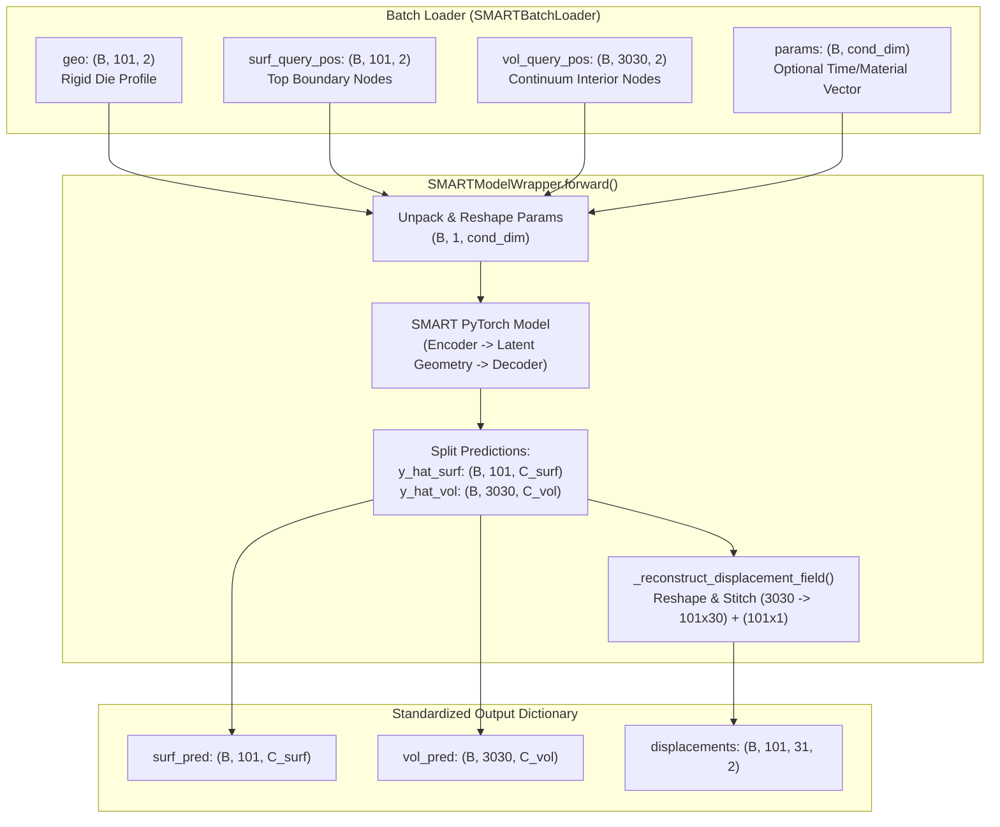

# Model Wrapper: `SMARTModelWrapper`

This document provides technical documentation for [`SMARTModelWrapper`](file:///home/arturobaltanas/University/GuidedResearch/src/training/wrappers/smart_wrapper.py#L23), the concrete model wrapper encapsulating the **SMART** (*Scalable Mesh Autoregressive Transformer*) architecture within the surrogate training and evaluation subsystems.

---

## 1. High-Level Overview & Architectural Role

In the 9-stage framework described in [`training_architecture.md`](file:///home/arturobaltanas/University/GuidedResearch/doc/arquitecture/training_architecture.md), the **`ModelWrapper`** fulfills the **Adapter Pattern** between model-agnostic orchestrators ([`TrainingEngine`](file:///home/arturobaltanas/University/GuidedResearch/src/training/engine.py#L19) and [`EvaluationEngine`](file:///home/arturobaltanas/University/GuidedResearch/src/evaluation/engine.py#L24)) and the deep learning neural network.

The native `SMART` architecture (located in [`external/smart`](file:///home/arturobaltanas/University/GuidedResearch/external/smart/smart/models/smart/smart.py#L436)) was originally designed for 3D vehicle aerodynamics and expects partitioned inputs:
1. An input geometry point cloud (`geo`) representing an obstacle.
2. Surface query points (`surf_query_pos`) for boundary fields (e.g., surface pressure).
3. Volume query points (`vol_query_pos`) for flow fields (e.g., fluid velocity).

In our **2D elastoplastic forging benchmark**, the physical domain consists of:
* A curved rigid die profile (`die_boundary`) with $101$ nodes.
* A deformable workpiece discretized into an orthogonal mesh of $101 \times 31 = 3131$ nodes (30 interior rows = 3030 volume nodes, and 1 top contact boundary row = 101 surface nodes).
* A full 2D displacement field tensor of shape `(B, 101, 31, 2)`.

[`SMARTModelWrapper`](file:///home/arturobaltanas/University/GuidedResearch/src/training/wrappers/smart_wrapper.py#L23) bridges this gap:
* It **instantiates and initializes** the underlying `SMART` PyTorch model.
* It **unpacks and routes** batch tensors (`geo`, `surf_query_pos`, `vol_query_pos`, and conditioning `params`) into `SMART.forward(...)`.
* It **reconstructs** the partitioned outputs (`surf_pred` and `vol_pred`) back into the unified 4D continuum displacement tensor `(B, 101, 31, 2)`.
* It **exposes** the raw `torch.nn.Module` via `get_torch_module()` for optimizer registration and checkpoint serialization.



---

## 2. Constructor: `__init__(config)`

### Signature
```python
def __init__(self, config: Optional[Dict[str, Any]] = None) -> None:
```

### Parameters

* **`config`** (`Optional[Dict[str, Any]]`, default=`None`):
  Configuration dictionary specifying the architectural hyperparameters for `SMART`. If `None` or omitted, defaults are automatically populated to match the 2D elastoplastic forging benchmark.

### Detailed Hyperparameter Specifications

The constructor reads the following key-value pairs from `config`:

| Parameter Key | Data Type | Default Value | Description & Physical Role |
| :--- | :--- | :--- | :--- |
| **`spatial_dim`** | `int` | `2` | Number of spatial coordinate dimensions ($D = 2$ for 2D plane strain forging with $(x, y)$ coordinates). Directs the coordinate projection layers and positional embedding dimensions. |
| **`surface_channels`** | `int` | `2` | Number of predicted physical variables along the top contacting boundary. Set to `2` for full displacement vector $(u_x, u_y)$, or `1` for vertical displacement $u_y$ only. |
| **`volume_channels`** | `int` | `2` | Number of predicted physical variables in the interior continuum. Set to `2` for full displacement vector $(u_x, u_y)$. |
| **`parameter_channels`** | `int` | `0` | Dimensionality of global conditioning parameters (`cond_dim`). Use `0` for static/final-step prediction, `1` for time-conditioned dynamic trajectories ($t \in [0, 1]$), or $>1$ for multi-parameter conditioning (e.g. material constants, friction coefficients). |
| **`latent_dim`** | `int` | `128` | Hidden representation dimension across all Transformer encoder-decoder blocks, feed-forward sublayers, and multi-head attention projections. |
| **`latent_geometry_points`** | `int` | `64` | Number of latent geometry anchor points ($N_{\text{lat}}$) randomly sampled from the input die geometry during encoding. Governs geometric bottleneck compression. |
| **`subsampled_geometry_points`** | `int` | `101` | Number of geometry points sampled for cross-attention in each encoder block. For our 2D forging dataset, the die contour contains exactly $101$ points, so `101` preserves the entire die boundary. |
| **`num_encoder_decoder_blocks`** | `int` | `6` | Number of stacked Transformer encoder and decoder layers, controlling model depth and expressive capacity. |
| **`num_heads`** | `int` | `8` | Number of parallel attention heads in multi-head self-attention and cross-attention. Must divide `latent_dim` evenly (e.g. $128 / 8 = 16$ channels per head). |
| **`pos_scale_factor`** | `float` | `1000.0` | Multiplicative scale factor applied to normalized $[0, 1]$ coordinates prior to trigonometric positional embedding computation, controlling dynamic range usage. |
| **`dropout`** | `float` | `0.0` | Dropout probability applied across Transformer attention weights and dense layers for regularization. |

### Parameter Mapping to Original SMART Paper (Hagnberger & Niepert, ICML 2026)

Below is the direct correspondence between each configuration parameter in `smart_config` and the formal parameters defined in the foundational paper [SMART: Scalable Mesh-free Aerodynamic Simulations from Raw Geometries using a Transformer](file:///home/arturobaltanas/University/GuidedResearch/doc/studies/SMARTpaper.pdf):

| Clave en `smart_config` | Símbolo en el Paper | Nombre en el Paper (Sec. 3 / Tabla 13) | Valor en el Paper (CFD 3D) | Valor en tu Benchmark (Plasticidad 2D) |
| :--- | :---: | :--- | :---: | :---: |
| `spatial_dim` | Dimensión de $\Omega$ | Spatial domain dimensionality ($x, y, z$) | `3` | `2` $(x, y)$ |
| `surface_channels` | $N_{c,\text{surf}}$ | Physical surface target quantities | `1` (Presión $p$) | `2` $(u_x, u_y)$ |
| `volume_channels` | $N_{c,\text{vol}}$ | Physical volume target quantities | `3` (Velocidad $u, v, w$) | `2` $(u_x, u_y)$ |
| `parameter_channels` | $N_p$ (dim de $\xi$) | Simulation parameters $\xi \in \mathbb{R}^{N_p}$ | `2` (Mach, ángulo $\alpha$) | `1` (Tiempo $t \in [0, 1]$) |
| `subsampled_geometry_points` | $N'$ | Points in Sampled Geometry $\tilde{G}_{\text{sub}}$ | `4,096` – `16,384` | `101` (todos los puntos del troquel) |
| `latent_dim` | $d$ | Latent feature dimension $d$ | `128` o `256` | `128` (ampliable a 256) |
| `latent_geometry_points` | $K$ | Points of Latent Geometry $K$ | `2,048` – `4,096` | `64` |
| `num_encoder_decoder_blocks` | $L$ | Number of Encoder/Decoder blocks | `6` u `8` | `6` (ampliable a 8) |
| `num_heads` | $h$ | Attention heads in `CrossAttn` | `8` | `8` |
| `pos_scale_factor` | Escala de $x$ en $\text{MPE}$ | Multiplicative coordinate scale factor | `1000.0` | `1000.0` |
| `dropout` | $\text{drop}$ | Dropout probability | `0.0` | `0.0` |

### Initialization Workflow

1. **Submodule Discoverability & Validation:**
   The wrapper ensures `external/smart` is present on `sys.path`. If `SMART` cannot be imported (e.g., git submodule was not cloned), it raises an informative `ImportError`:
   ```python
   raise ImportError(
       "Failed to import SMART from external/smart. "
       "Ensure git submodules are initialized: git submodule update --init --recursive"
   )
   ```

2. **Hyperparameter Parsing:**
   Reads each parameter from `config`, casting to `int` or `float` with safe fallbacks.

3. **Model Instantiation:**
   Instantiates `self.model = SMART(...)` with the parsed configuration.

4. **Weight Initialization:**
   Invokes `self.model.initialize_weights()`, initializing linear layer weights with truncated normal distribution ($\sigma = 0.02$) and LayerNorm biases/weights to $0.0 / 1.0$.

---

## 3. Forward Execution: `forward(batch)`

### Signature
```python
def forward(self, batch: Dict[str, torch.Tensor]) -> Dict[str, torch.Tensor]:
```

### Input Batch Arguments (`batch`)

The `batch` dictionary is provided by [`SMARTBatchLoader`](file:///home/arturobaltanas/University/GuidedResearch/src/training/batch_loaders.py#L15) and contains the following tensors:

| Dictionary Key | Tensor Shape | Data Type | Value Range | Description |
| :--- | :--- | :--- | :--- | :--- |
| **`"geo"`** | `(B, 101, 2)` | `torch.float32` | $[0, 1]$ | Spatial coordinates of the rigid die boundary contour, normalized using global domain bounds. |
| **`"surf_query_pos"`** | `(B, 101, 2)` | `torch.float32` | $[0, 1]$ | Spatial coordinates of the top boundary workpiece nodes ($y \approx 15.0$ mm), normalized to $[0, 1]$. |
| **`"vol_query_pos"`** | `(B, 3030, 2)` | `torch.float32` | $[0, 1]$ | Spatial coordinates of the interior continuum workpiece nodes ($101 \times 30 = 3030$), normalized to $[0, 1]$. |
| **`"params"`** *(optional)* | `(B, cond_dim)` or `(B, 1, cond_dim)` | `torch.float32` | Arbitrary / $[0, 1]$ | Optional global conditioning parameters (e.g. time $t$). If provided as 2D `(B, cond_dim)`, the wrapper automatically unsqueezes to `(B, 1, cond_dim)` to broadcast over all spatial query points. |

### Execution Pipeline

1. **Parameter Reshaping:**
   If `params` is provided and has 2 dimensions `(B, cond_dim)`, it is unsqueezed along dimension 1:
   ```python
   if params is not None and params.ndim == 2:
       params = params.unsqueeze(1)  # (B, 1, cond_dim)
   ```

2. **Core Forward Pass:**
   Calls the underlying `SMART` model:
   ```python
   y_hat_surf, y_hat_vol = self.model(
       geo=geo,
       surf_query_pos=surf_query_pos,
       vol_query_pos=vol_query_pos,
       params=params,
   )
   ```
   * Geometry encoding (`self.model.encode`):
     - Multiplies `geo` by `pos_scale_factor`.
     - Subsamples `latent_geometry_points` to construct latent geometric tokens.
     - Runs through $N$ encoder blocks with geometry cross-attention.
   * Query decoding (`self.model.decode`):
     - Concatenates surface and volume queries: `query_pos = cat([surf_query_pos, vol_query_pos], dim=1)` ($101 + 3030 = 3131$ query points).
     - Decodes latent geometry representations into query embeddings.
     - Projects query embeddings through final MLP.
   * Partitions outputs into `y_hat_surf` and `y_hat_vol`.

3. **Displacement Field Reconstruction:**
   Calls internal helper `_reconstruct_displacement_field(...)` to stitch the partitioned surface and volume predictions into the complete workpiece grid.

---

## 4. Output After Executing `forward`

The `forward()` method returns a dictionary containing **three PyTorch tensors**:

```python
return {
    "surf_pred": y_hat_surf,
    "vol_pred": y_hat_vol,
    "displacements": full_displacements,
}
```

### Output Tensor Specifications

| Key | Tensor Shape | Data Type | Target Domain / Channels | Description & Consumer |
| :--- | :--- | :--- | :--- | :--- |
| **`"surf_pred"`** | `(B, 101, C_surf)` | `torch.float32` | $C_{\text{surf}} \in \{1, 2\}$ | Raw predictions on the contact surface query nodes. Evaluated directly by [`RelativeL2LossEngine`](file:///home/arturobaltanas/University/GuidedResearch/src/training/losses.py#L10) against target `targets["surf_data"]`. |
| **`"vol_pred"`** | `(B, 3030, C_vol)` | `torch.float32` | $C_{\text{vol}} = 2$ | Raw predictions on the interior continuum query nodes. Evaluated directly by [`RelativeL2LossEngine`](file:///home/arturobaltanas/University/GuidedResearch/src/training/losses.py#L10) against target `targets["vol_data"]`. |
| **`"displacements"`** | `(B, 101, 31, 2)` | `torch.float32` | Full 2D vector field $(u_x, u_y)$ across $101 \times 31$ mesh | Reconstructed, unified displacement field across all $3131$ workpiece nodes. Consumed by contact penetration penalty losses, [`EvaluationEngine`](file:///home/arturobaltanas/University/GuidedResearch/src/evaluation/engine.py#L24), physical denormalizers, and visualization scripts. |

### The Field Reconstruction Algorithm (`_reconstruct_displacement_field`)

The 2D forging mesh is structured as $101$ horizontal nodes by $31$ vertical nodes:
* The first $30$ vertical rows ($y \in [0, 29]$) correspond to interior continuum nodes ($101 \times 30 = 3030$).
* The top vertical row ($y = 30$, index `-1`) corresponds to the contact boundary surface ($101 \times 1 = 101$).

```text
  y = 30  [Top Surface Boundary]      -------------------- (101 nodes, C_surf)
  y = 29  [Interior Continuum Layer]   ....................
  ...     ...
  y = 0   [Bottom Fixed Boundary]      .................... (101 x 30 = 3030 nodes, C_vol)
                                        x = 0  ...  x = 100
```

The reconstruction executes the following steps:

1. **Volume Reshaping:**
   Reshapes `vol_pred` from flattened query shape `(B, 3030, C_vol)` into 3D grid format:
   ```python
   vol_mesh = vol_pred.reshape(batch_size, 101, 30, -1)  # (B, 101, 30, 2)
   ```

2. **Surface Channel Adaptation:**
   * If `surface_channels == 2`: Adds mesh height dimension:
     ```python
     surf_mesh = surf_pred.unsqueeze(2)  # (B, 101, 1, 2)
     ```
   * If `surface_channels == 1` (vertical displacement $u_y$ only): Zero-fills horizontal displacement $u_x$ and concatenates:
     ```python
     surf_ux = torch.zeros((batch_size, 101, 1, 1), device=device, dtype=surf_pred.dtype)
     surf_uy = surf_pred.unsqueeze(2)  # (B, 101, 1, 1)
     surf_mesh = torch.cat([surf_ux, surf_uy], dim=-1)  # (B, 101, 1, 2)
     ```
   * If `surface_channels > 2`: Slices the first two displacement components:
     ```python
     surf_mesh = surf_pred[:, :, :2].unsqueeze(2)  # (B, 101, 1, 2)
     ```

3. **Unified Concatenation:**
   Concatenates interior volume and top surface along the vertical $y$-dimension ($dim=2$):
   ```python
   full_u = torch.cat([vol_mesh[:, :, :, :2], surf_mesh[:, :, :, :2]], dim=2)
   # Shape: (B, 101, 30 + 1, 2) = (B, 101, 31, 2)
   ```

---

## 5. Auxiliary Methods

### `get_torch_module()`

```python
def get_torch_module(self) -> nn.Module:
```
* **Purpose:** Exposes the encapsulated `SMART` `torch.nn.Module` instance.
* **Return Value:** `self.model` (`nn.Module`).
* **Usage:** Used by [`OptimizerController`](file:///home/arturo/GuidedResearch/TransformerSurrogatesPDEs-GuidedResearch/src/training/optimizers.py) to register trainable parameters:
  ```python
  torch_module = model_wrapper.get_torch_module()
  optimizer = OptimizerController.create_adamw(torch_module.parameters(), lr=1e-3)
  ```
  Also used for device placement (`torch_module.to(device)`) and state dictionary serialization in [`TorchCheckpointHandler`](file:///home/arturobaltanas/University/GuidedResearch/src/training/checkpoints.py#L12).

---

## 6. Concrete Usage Examples

### Example 1: Final-Step (Steady-State) Training Setup

In final-step training (e.g. [`scripts/train_smart_final_step.py`](file:///home/arturobaltanas/University/GuidedResearch/scripts/train_smart_final_step.py)), the model predicts final deformation without time conditioning:

```python
from src.training.wrappers.smart_wrapper import SMARTModelWrapper

# 1. Define configuration dictionary
smart_config = {
    "spatial_dim": 2,
    "surface_channels": 2,
    "volume_channels": 2,
    "parameter_channels": 0,       # No time conditioning
    "latent_dim": 128,
    "latent_geometry_points": 64,
    "subsampled_geometry_points": 101,
    "num_encoder_decoder_blocks": 6,
    "num_heads": 8,
    "pos_scale_factor": 1000.0,
    "dropout": 0.0,
}

# 2. Instantiate wrapper
model_wrapper = SMARTModelWrapper(config=smart_config)

# 3. Retrieve PyTorch module for optimizer
torch_module = model_wrapper.get_torch_module()
print(f"Total Parameters: {sum(p.numel() for p in torch_module.parameters()):,}")
```

### Example 2: Time-Conditioned (Temporal) Trajectory Setup

In time-dependent simulation training (e.g. [`scripts/train_smart_temporal.py`](file:///home/arturobaltanas/University/GuidedResearch/scripts/train_smart_temporal.py)), `parameter_channels=1` enables trajectory prediction as a function of simulation time $t \in [0, 1]$:

```python
smart_config = {
    "spatial_dim": 2,
    "surface_channels": 2,
    "volume_channels": 2,
    "parameter_channels": 1,       # Conditioned on normalized time t
    "latent_dim": 128,
    "latent_geometry_points": 64,
    "subsampled_geometry_points": 101,
    "num_encoder_decoder_blocks": 6,
    "num_heads": 8,
    "pos_scale_factor": 1000.0,
    "dropout": 0.0,
}

model_wrapper = SMARTModelWrapper(config=smart_config)
```

### Example 3: Forward Pass Verification & Output Shapes

```python
import torch
from src.training.wrappers.smart_wrapper import SMARTModelWrapper

wrapper = SMARTModelWrapper()

# Synthetic batch matching SMARTBatchLoader output
batch_size = 4
batch = {
    "geo": torch.rand(batch_size, 101, 2),
    "surf_query_pos": torch.rand(batch_size, 101, 2),
    "vol_query_pos": torch.rand(batch_size, 3030, 2),
    "params": torch.rand(batch_size, 1),
}

# Execute forward
predictions = wrapper.forward(batch)

print("surf_pred shape:    ", predictions["surf_pred"].shape)     # torch.Size([4, 101, 2])
print("vol_pred shape:     ", predictions["vol_pred"].shape)      # torch.Size([4, 3030, 2])
print("displacements shape:", predictions["displacements"].shape)  # torch.Size([4, 101, 31, 2])
```

---

## 7. Related Components and References

* [`SMARTModelWrapper` Implementation](file:///home/arturobaltanas/University/GuidedResearch/src/training/wrappers/smart_wrapper.py)
* [`ModelWrapper` Interface](file:///home/arturobaltanas/University/GuidedResearch/src/training/interfaces.py#L35-L68)
* [`SMARTBatchLoader` Implementation](file:///home/arturobaltanas/University/GuidedResearch/src/training/batch_loaders.py#L15)
* [`Training Architecture Document`](file:///home/arturobaltanas/University/GuidedResearch/doc/arquitecture/training_architecture.md)
* [`SMART Model Architecture and Adaptation Guide`](file:///home/arturobaltanas/University/GuidedResearch/doc/studies/smart_model_architecture_and_dataset_adaptation.md)
* [`Core SMART PyTorch Module`](file:///home/arturobaltanas/University/GuidedResearch/external/smart/smart/models/smart/smart.py#L436)
