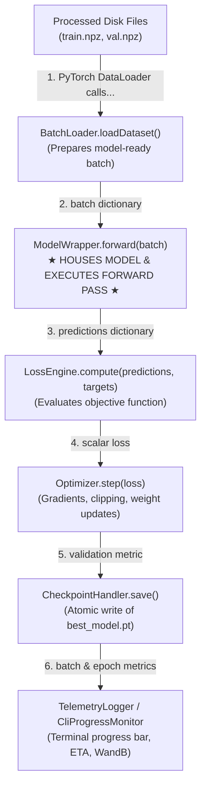

# Training Architecture: `TrainingEngine`

This document details the architectural design, component responsibilities, and technical specifications of the surrogate model training subsystem, centered around the **`TrainingEngine`** orchestrator.

---

## 1. High-Level Executive Summary: The 9-Stage Framework

To maintain modularity and scientific rigor across all milestones (SMART, uPDEt, and operator baselines), the codebase is organized into nine distinct stages:

1. **`DatasetEngine`:** Preprocesses raw simulation files (e.g., ABAQUS `.mat`) and saves clean, partitioned NumPy archives to disk (`train.npz`, `val.npz`, `test.npz`, `statistical_data.json`).
2. **`BatchLoader`:** Reads simulation samples from disk partitions and prepares them into model-specific PyTorch tensor batches (`loadDataset`).
3. **`ModelWrapper`:** Houses and instantiates the deep learning model (e.g., SMART, uPDEt), executes the forward pass, and standardizes input/output tensor shapes.
4. **`LossEngine`:** Measures surrogate prediction errors against ground-truth simulation physics (e.g., Relative $L_2$, Mean Squared Error, boundary penalties).
5. **`Optimizer`:** Computes parameter gradients, applies gradient clipping, updates neural network weights, and steps the learning rate schedule.
6. **`CheckpointHandler`:** Persists model weights, optimizer states, and epoch metadata to disk whenever validation metrics achieve a new best.
7. **`TelemetryLogger` (`CliProgressMonitor`):** Renders real-time terminal progress bars, percentage completion, hardware utilization, and estimated time of arrival (ETA).
8. **`TrainingEngine`:** The central orchestrator that coordinates the outer epoch loop and inner batch loops, connecting all training components seamlessly.
9. **`EvaluationEngine`:** Post-training validator that evaluates checkpoints on unobserved test data in real physical units (millimeters), verifies solid mechanics contact adherence, measures inference speed, and exports publication artifacts.

---

## 2. Core Architectural Philosophy: Decoupled Orchestration

Rather than relying on model-specific, monolithic training scripts (which duplicate training loops, optimizer settings, and logging logic), the system adopts **Composition over Inheritance** through the Strategy and Wrapper patterns.



### The Physical Reality vs. Model-Specific Demands
Understanding why we separate `BatchLoader` and `ModelWrapper` requires looking at the physical problem:
* **Our Physical Simulation (2D Elastoplastic Forging):**
  - **Tool:** A rigid upper die / punch with a curved profile (`die_boundary`, **$101$ points**). In each simulation, the die shape is different.
  - **Workpiece:** A deformable rectangular metal block discretized into a mesh of $101 \times 31 =$ **$3131$ nodes**.
  - **Goal:** Predict the final deformation coordinates $(X, Y)$ and displacement vectors $(u_x, u_y)$ of all $3131$ metal nodes when struck by the die.
* **The Model Mismatch:**
  - Standard operator models (such as Fourier Neural Operators or UNets) expect regular 2D grid tensors of shape $(B, 101, 31, C)$.
  - Conversely, transformer models like **SMART** were originally designed for 3D vehicle aerodynamics, where inputs are hard-coded into:
    1. A geometry point cloud (`geo`) representing an obstacle.
    2. Surface query points (`surf_query_pos`) evaluating surface fields (pressure).
    3. Volume query points (`vol_query_pos`) evaluating flow fields (air velocity).
* **The Solution:**
  - We do **not** rewrite our clean dataset files to fit SMART, nor do we alter SMART's source code.
  - Instead, **`BatchLoader`** formats the inputs specifically for the target model, and **`ModelWrapper`** translates the model's outputs back into standard physical tensors. `TrainingEngine` remains completely clean and model-agnostic.

---

## 3. UML Class Diagram


---

## 4. In-Depth Component Specifications & Responsibilities

### 4.1 `BatchLoader` (Data Boundary Strategy)
* **Contract:** `loadDataset(samples: List[Dict[str, np.ndarray]]) -> Dict[str, torch.Tensor]`
* **Purpose:** Custom collation logic passed to PyTorch's `DataLoader(collate_fn=batch_loader.loadDataset)`. Converts raw NumPy dictionaries into batched, coordinate-scaled, type-casted PyTorch tensors.
* **Implementations:**
  - **`SMARTBatchLoader`:** Bridges 2D forging into SMART's 3-part input signature:
    1. **`geo` ($101$ points):** The rigid die contour (`die_boundary`), normalized from physical millimeter coordinates ($[-49.65, 0.35] \times [14.1, 26.1]$) into unit bounding-box coordinates $[0, 1]^2$.
    2. **`surf_query_pos` ($101$ points):** The top surface row of the undeformed metal workpiece ($y \approx 15.0$ mm), scaled to $[0, 1]^2$.
    3. **`vol_query_pos` ($3030$ points):** The interior $101 \times 30$ continuum nodes of the undeformed workpiece, flattened and scaled to $[0, 1]^2$.
    4. **`targets`:** Normalizes ground-truth displacements partitioned into `surf_data` `(B, 101, 1)` and `vol_data` `(B, 3030, 2)`.
  - **`StandardBatchLoader`:** Packs the full workpiece directly as a grid tensor `(B, 101, 31, 2)` for architectures like FNO or uPDEt without partitioning nodes.

### 4.2 `ModelWrapper` (Model Boundary & Forward Execution)
* **Contract:**
  - `forward(batch: Dict[str, torch.Tensor]) -> Dict[str, torch.Tensor]`
  - `get_torch_module() -> torch.nn.Module`
* **Purpose:** **Houses, initializes, and owns the deep learning model instance.** It isolates model-specific forward signatures and reconstructs unified prediction tensors.
* **Responsibilities:**
  1. **Instantiation:** In `__init__`, it instantiates the neural network (`self.model = SMART(...)`) using provided architecture hyperparameters.
  2. **Parameter Exposure:** Exposes `get_torch_module()` so that PyTorch optimizers can register the model's trainable parameters (`optimizer = AdamW(wrapper.get_torch_module().parameters())`).
  3. **Forward Translation:** Unpacks `batch` keys, executes the forward pass, and collects the model's raw outputs.
  4. **Output Reconstruction:** Reassembles partitioned outputs into a standard dictionary containing the full displacement field `(B, 101, 31, 2)`.
* **SMART Implementation (`SMARTModelWrapper`):**
  ```python
  class SMARTModelWrapper(ModelWrapper):
      def __init__(self, architecture_config: Dict[str, Any]) -> None:
          # 1. Instantiates the deep learning model internally
          self.model = SMART(
              spatial_dim=2,
              surface_channels=1,
              volume_channels=2,
              latent_dim=architecture_config.get("latent_dim", 256),
              latent_geometry_points=architecture_config.get("latent_geo_points", 64),
              subsampled_geometry_points=architecture_config.get("subsampled_points", 101),
              num_encoder_decoder_blocks=architecture_config.get("num_blocks", 6),
              num_heads=architecture_config.get("num_heads", 8),
          )

      def forward(self, batch: Dict[str, torch.Tensor]) -> Dict[str, torch.Tensor]:
          # 2. Feeds model-specific keyword arguments into the model
          y_hat_surf, y_hat_vol = self.model(
              geo=batch["geo"],
              surf_query_pos=batch["surf_query_pos"],
              vol_query_pos=batch["vol_query_pos"],
              params=batch.get("params", None),
          )
          # 3. Stitches partitioned predictions back into the full (B, 101, 31, 2) tensor
          full_displacements = self._reconstruct_displacement_field(y_hat_surf, y_hat_vol)
          return {
              "displacements": full_displacements,
              "surf_pred": y_hat_surf,
              "vol_pred": y_hat_vol,
          }

      def get_torch_module(self) -> torch.nn.Module:
          return self.model
  ```

### 4.3 `LossEngine` (Objective Formulation)
* **Contract:** `compute(predictions: Dict[str, torch.Tensor], targets: Dict[str, torch.Tensor], batch: Dict[str, torch.Tensor]) -> Tuple[torch.Tensor, Dict[str, float]]`
* **Purpose:** Computes the scalar loss for backpropagation alongside individual component losses for telemetry tracking.
* **Implementations:**
  - **`RelativeL2LossEngine`:** Computes the relative Frobenius norm on normalized displacements:
    $$\mathcal{L}_{\text{RelL2}}(\hat{\mathbf{u}}, \mathbf{u}) = \frac{\|\hat{\mathbf{u}} - \mathbf{u}\|_2}{\|\mathbf{u}\|_2 + \epsilon}$$
  - **`CompositePhysicsLossEngine`:** Adds soft mechanics constraints (e.g., penalizing workpiece penetration through the die contour):
    $$\mathcal{L}_{\text{total}} = \mathcal{L}_{\text{RelL2}} + \lambda_{\text{contact}} \mathcal{L}_{\text{penetration}}$$

### 4.4 `Optimizer` (Optimization & Learning Rate Schedule)
* **Contract:**
  - `zero_grad() -> None`
  - `step(loss: torch.Tensor, max_grad_norm: Optional[float] = None) -> float`
  - `epoch_step(metric: Optional[float] = None) -> float`
  - `get_learning_rate() -> float`
* **Purpose:** Manages `optimizer.zero_grad()`, backpropagation (`loss.backward()`), gradient clipping norm computation (`torch.nn.utils.clip_grad_norm_`), optimizer steps (AdamW), and learning rate scheduler updates (CosineAnnealingLR or ReduceLROnPlateau).

### 4.5 `CheckpointHandler` (Atomic Persistence)
* **Contract:**
  - `save(epoch: int, model: nn.Module, metrics: Dict[str, float], is_best: bool) -> Path`
  - `load_best(model: nn.Module) -> Dict[str, Any]`
  - `get_best_checkpoint_path() -> Path`
* **Purpose:** Saves model weights, optimizer states, and epoch counters to disk. Implements atomic writes (writing to `.pt.tmp` before renaming) to eliminate corrupt files caused by sudden job termination or cluster timeouts.

### 4.6 `TelemetryLogger` & `CliProgressMonitor` (Live Interactive Terminal)
* **Contract:**
  - `start_epoch(epoch: int, total_epochs: int, total_batches: int) -> None`
  - `update_batch(batch_idx: int, loss_val: float, lr: float) -> None`
  - `end_epoch(epoch: int, total_epochs: int, train_metrics: Dict[str, float], val_metrics: Dict[str, float], lr: float) -> None`
  - `close() -> None`
* **Purpose:** Provides interactive feedback during training. Calculates dynamic progress percentages, processing speeds (`samples/s`), active CUDA VRAM allocation, and dual ETA estimations (remaining epoch time and remaining total run time).

---

## 5. Interactive CLI Monitoring & Terminal Display

The **`CliProgressMonitor`** formats terminal output cleanly, providing complete visibility over training execution:

```text
========================================================================================================
[TrainingEngine] Active Run: SMART-Plasticity (Total Epochs: 100, Batch Size: 16)
Hardware: NVIDIA A100-SXM4-80GB | CUDA VRAM Initial: 1.84 GB
========================================================================================================
Epoch [14/100] ── 45% [=====================>...........................] 25/56 Batches
  • Elapsed: 00:01:12 | Epoch ETA: 00:01:28 | Total Job ETA: 02:44:10
  • Throughput: 5.56 batches/s (88.9 samples/s) | GPU VRAM: 3.45 GB / 80.00 GB
  • Batch Loss: 0.0412 (Smoothed: 0.0435) | Learning Rate: 1.00e-04
────────────────────────────────────────────────────────────────────────────────────────────────────────
✔ Epoch [14/100] Complete (02:39s) ── Train RelL2: 0.0421 | Val RelL2: 0.0458 | LR: 9.85e-05
  ★ New Record Validation Metric! Checkpoint saved: results/checkpoints/best_model.pt
========================================================================================================
```

---

## 6. Complete Orchestration Workflow

The Python implementation below demonstrates the exact execution flow of [`TrainingEngine`](file:///home/arturobaltanas/University/Guided%20Research/src/training/engine.py):

```python
"""Orchestrator for surrogate model training, validation, and optimization."""

import time
from pathlib import Path
from typing import Any, Dict, List, Optional
import torch
import torch.nn as nn
from torch.utils.data import DataLoader

from src.training.interfaces import (
    BatchLoader,
    CheckpointHandler,
    LossEngine,
    ModelWrapper,
    Optimizer,
    TelemetryLogger,
)


class CliProgressMonitor(TelemetryLogger):
    """Real-time terminal monitor displaying completion percentage, throughput, and dual ETA."""

    def __init__(self) -> None:
        self.job_start_time: float = 0.0
        self.epoch_start_time: float = 0.0
        self.total_batches: int = 0
        self.total_epochs: int = 0
        self.batch_times: List[float] = []

    def start_epoch(self, epoch: int, total_epochs: int, total_batches: int) -> None:
        if self.job_start_time == 0.0:
            self.job_start_time = time.time()
        self.epoch_start_time = time.time()
        self.total_batches = total_batches
        self.total_epochs = total_epochs
        self.batch_times.clear()

    def update_batch(self, batch_idx: int, loss_val: float, lr: float) -> None:
        now = time.time()
        elapsed_epoch = now - self.epoch_start_time
        avg_batch_time = elapsed_epoch / max(1, batch_idx)
        self.batch_times.append(avg_batch_time)

        remaining_batches = self.total_batches - batch_idx
        epoch_eta_s = remaining_batches * avg_batch_time

        progress_pct = (batch_idx / self.total_batches) * 100.0
        bar_len = 25
        filled = int(bar_len * (batch_idx / self.total_batches))
        bar = "=" * filled + ">" + "." * max(0, bar_len - filled - 1)
        if filled >= bar_len:
            bar = "=" * bar_len

        vram_mb = 0.0
        if torch.cuda.is_available():
            vram_mb = torch.cuda.max_memory_allocated() / (1024 ** 2)

        print(
            f"\rEpoch Batch [{batch_idx:02d}/{self.total_batches:02d}] "
            f"[{bar}] {progress_pct:5.1f}% | "
            f"Epoch ETA: {int(epoch_eta_s // 60):02d}:{int(epoch_eta_s % 60):02d} | "
            f"Loss: {loss_val:.4e} | LR: {lr:.2e} | VRAM: {vram_mb:.0f}MB",
            end="",
            flush=True,
        )

    def end_epoch(
        self,
        epoch: int,
        total_epochs: int,
        train_metrics: Dict[str, float],
        val_metrics: Dict[str, float],
        lr: float,
    ) -> None:
        epoch_time = time.time() - self.epoch_start_time
        total_elapsed = time.time() - self.job_start_time
        remaining_epochs = total_epochs - epoch
        avg_epoch_time = total_elapsed / epoch
        total_eta_s = remaining_epochs * avg_epoch_time

        print(
            f"\n✔ Epoch [{epoch:03d}/{total_epochs:03d}] Finished in {epoch_time:.1f}s | "
            f"Total Job ETA: {int(total_eta_s // 3600):02d}h {int((total_eta_s % 3600) // 60):02d}m | "
            f"Train RelL2: {train_metrics.get('loss_total', 0.0):.4e} | "
            f"Val RelL2: {val_metrics.get('loss_total', 0.0):.4e} | LR: {lr:.2e}"
        )

    def close(self) -> None:
        total_time = time.time() - self.job_start_time
        print(f"\n" + "=" * 70)
        print(f"Training Complete in {int(total_time // 3600):02d}h {int((total_time % 3600) // 60):02d}m {int(total_time % 60):02d}s")
        print("=" * 70)


class TrainingEngine:
    """Coordinates surrogate model training, validation, optimization, and checkpointing.

    Parameters
    ----------
    model_wrapper : ModelWrapper
        Wrapper housing and executing the neural network architecture.
    batch_loader : BatchLoader
        Strategy preparing raw partition samples into model-ready tensor batches.
    loss_engine : LossEngine
        Objective calculation strategy.
    optimizer : Optimizer
        Optimizer and learning rate schedule manager.
    checkpointer : CheckpointHandler
        Checkpoint persistence manager.
    logger : TelemetryLogger
        Telemetry and metrics logging observer.
    """

    def __init__(
        self,
        model_wrapper: ModelWrapper,
        batch_loader: BatchLoader,
        loss_engine: LossEngine,
        optimizer: Optimizer,
        checkpointer: CheckpointHandler,
        logger: TelemetryLogger,
    ) -> None:
        self.model_wrapper = model_wrapper
        self.batch_loader = batch_loader
        self.loss_engine = loss_engine
        self.optimizer = optimizer
        self.checkpointer = checkpointer
        self.logger = logger

    def train(
        self,
        train_loader: DataLoader,
        val_loader: DataLoader,
        epochs: int,
        device: torch.device,
        max_grad_norm: Optional[float] = 1.0,
    ) -> Dict[str, Any]:
        """Execute full training and validation schedule.

        Parameters
        ----------
        train_loader : DataLoader
            DataLoader wrapping the training partition.
        val_loader : DataLoader
            DataLoader wrapping the validation partition.
        epochs : int
            Total training epochs.
        device : torch.device
            Hardware target device (e.g. cuda:0 or cpu).
        max_grad_norm : Optional[float]
            Maximum gradient norm threshold for clipping.

        Returns
        -------
        Dict[str, Any]
            Execution summary containing best validation loss and checkpoint paths.
        """
        best_val_loss = float("inf")
        model = self.model_wrapper.get_torch_module().to(device)

        for epoch in range(1, epochs + 1):
            self.logger.start_epoch(epoch, epochs, len(train_loader))

            # 1. Training step across batches
            train_metrics = self._train_epoch(train_loader, device, max_grad_norm)

            # 2. Validation step across batches
            val_metrics = self._validate_epoch(val_loader, device)

            # 3. Learning rate schedule step
            current_lr = self.optimizer.epoch_step(val_metrics["loss_total"])

            # 4. Telemetry logging
            self.logger.end_epoch(epoch, epochs, train_metrics, val_metrics, current_lr)

            # 5. Checkpointing
            val_loss = val_metrics["loss_total"]
            is_best = val_loss < best_val_loss
            if is_best:
                best_val_loss = val_loss

            self.checkpointer.save(
                epoch=epoch,
                model=model,
                metrics=val_metrics,
                is_best=is_best,
            )

        self.logger.close()
        return {
            "best_val_loss": best_val_loss,
            "best_checkpoint": self.checkpointer.get_best_checkpoint_path(),
        }

    def _train_epoch(
        self,
        dataloader: DataLoader,
        device: torch.device,
        max_grad_norm: Optional[float],
    ) -> Dict[str, float]:
        """Execute single training epoch across batches."""
        model = self.model_wrapper.get_torch_module()
        model.train()
        accumulated_losses: Dict[str, float] = {}
        total_batches = len(dataloader)

        for batch_idx, batch in enumerate(dataloader, start=1):
            batch = {k: v.to(device) if isinstance(v, torch.Tensor) else v for k, v in batch.items()}
            self.optimizer.zero_grad()

            # Forward pass executed via ModelWrapper
            predictions = self.model_wrapper.forward(batch)
            loss, loss_components = self.loss_engine.compute(predictions, batch["targets"], batch)

            # Backward pass and gradient step via Optimizer
            self.optimizer.step(loss, max_grad_norm=max_grad_norm)

            for k, v in loss_components.items():
                accumulated_losses[k] = accumulated_losses.get(k, 0.0) + v

            current_lr = self.optimizer.get_learning_rate()
            self.logger.update_batch(batch_idx, loss.item(), current_lr)

        return {k: v / total_batches for k, v in accumulated_losses.items()}

    def _validate_epoch(
        self,
        dataloader: DataLoader,
        device: torch.device,
    ) -> Dict[str, float]:
        """Execute validation epoch with gradients disabled."""
        model = self.model_wrapper.get_torch_module()
        model.eval()
        accumulated_losses: Dict[str, float] = {}
        total_batches = len(dataloader)

        with torch.no_grad():
            for batch in dataloader:
                batch = {k: v.to(device) if isinstance(v, torch.Tensor) else v for k, v in batch.items()}
                predictions = self.model_wrapper.forward(batch)
                _, loss_components = self.loss_engine.compute(predictions, batch["targets"], batch)

                for k, v in loss_components.items():
                    accumulated_losses[k] = accumulated_losses.get(k, 0.0) + v

        return {k: v / total_batches for k, v in accumulated_losses.items()}
```

---

## 7. Source Code Organization

The classes and strategies specified in this architecture are organized in the codebase as follows:

| Component Role | Class / Interface | Target File Location |
| :--- | :--- | :--- |
| **Interfaces** | `BatchLoader`, `ModelWrapper`, `LossEngine`, `Optimizer`, `CheckpointHandler`, `TelemetryLogger` | [`src/training/interfaces.py`](file:///home/arturobaltanas/University/Guided%20Research/src/training/interfaces.py) |
| **Batch Preparation** | `SMARTBatchLoader`, `StandardBatchLoader` | [`src/training/batch_loaders.py`](file:///home/arturobaltanas/University/Guided%20Research/src/training/batch_loaders.py) |
| **Model Wrappers** | `SMARTModelWrapper`, `UPDEtModelWrapper`, `BaselineFNOWrapper` | [`src/training/wrappers/smart_wrapper.py`](file:///home/arturobaltanas/University/Guided%20Research/src/training/wrappers/smart_wrapper.py) |
| **Loss Formulations** | `RelativeL2LossEngine`, `MSELossEngine`, `CompositePhysicsLossEngine` | [`src/training/losses.py`](file:///home/arturobaltanas/University/Guided%20Research/src/training/losses.py) |
| **Optimization** | `StandardOptimizer` | [`src/training/optimizers.py`](file:///home/arturobaltanas/University/Guided%20Research/src/training/optimizers.py) |
| **Persistence** | `TorchCheckpointHandler` | [`src/training/checkpoints.py`](file:///home/arturobaltanas/University/Guided%20Research/src/training/checkpoints.py) |
| **Telemetry & CLI** | `CliProgressMonitor`, `CompositeTelemetryLogger`, `WandbLogger` | [`src/training/loggers.py`](file:///home/arturobaltanas/University/Guided%20Research/src/training/loggers.py) |
| **Orchestration** | `TrainingEngine` | [`src/training/engine.py`](file:///home/arturobaltanas/University/Guided%20Research/src/training/engine.py) |
| **CLI Runner** | End-to-end training entry point | [`scripts/train_model.py`](file:///home/arturobaltanas/University/Guided%20Research/scripts/train_model.py) |
| **Test Suite** | Unit tests for training pipeline and strategies | [`tests/test_training_engine.py`](file:///home/arturobaltanas/University/Guided%20Research/tests/test_training_engine.py) |
