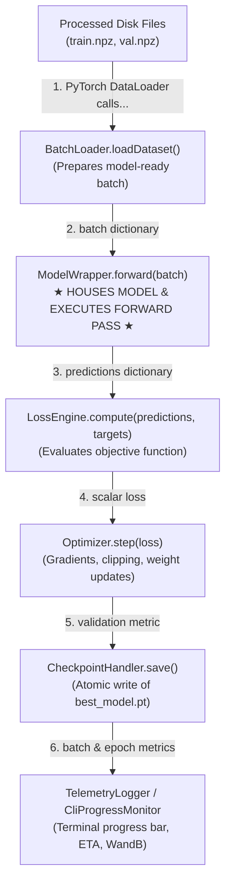
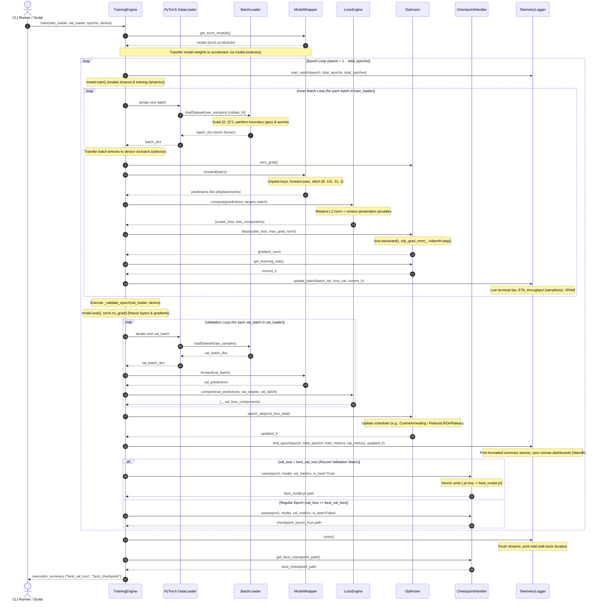

# Training Architecture: `TrainingEngine`

This document details the architectural design, component responsibilities, and technical specifications of the surrogate model training subsystem, centered around the **`TrainingEngine`** orchestrator.

---

## 1. High-Level Executive Summary: The 9-Stage Framework

To maintain modularity and scientific rigor across all milestones (SMART, uPDEt, and operator baselines), the codebase is organized into nine distinct stages:

1. **`DatasetEngine`:** Preprocesses raw simulation files (e.g., ABAQUS `.mat`) and saves clean, partitioned NumPy archives to disk (`train.npz`, `val.npz`, `test.npz`, `statistical_data.json`).
2. **`BatchLoader`:** Reads simulation samples from disk partitions and prepares them into model-specific PyTorch tensor batches (`loadDataset`).
3. **`ModelWrapper`:** Houses and instantiates the deep learning model (e.g., SMART, uPDEt), executes the forward pass, and standardizes input/output tensor shapes.
4. **`LossEngine`:** Measures surrogate prediction errors against ground-truth simulation physics (e.g., Relative $L_2$, Mean Squared Error, boundary penalties).
5. **`Optimizer`:** Computes parameter gradients, applies gradient clipping, updates neural network weights, and steps the learning rate schedule.
6. **`CheckpointHandler`:** Persists model weights, optimizer states, and epoch metadata to disk whenever validation metrics achieve a new best.
7. **`TelemetryLogger` (`CliProgressMonitor`):** Renders real-time terminal progress bars, percentage completion, hardware utilization, and estimated time of arrival (ETA).
8. **`TrainingEngine`:** The central orchestrator that coordinates the outer epoch loop and inner batch loops, connecting all training components seamlessly.
9. **`EvaluationEngine`:** Post-training validator that evaluates checkpoints on unobserved test data in real physical units (millimeters), verifies solid mechanics contact adherence, measures inference speed, and exports publication artifacts.

---

## 2. Core Architectural Philosophy: Decoupled Orchestration

Rather than relying on model-specific, monolithic training scripts (which duplicate training loops, optimizer settings, and logging logic), the system adopts **Composition over Inheritance** through the Strategy and Wrapper patterns.



### The Physical Reality vs. Model-Specific Demands
Understanding why we separate `BatchLoader` and `ModelWrapper` requires looking at the physical problem:
* **Our Physical Simulation (2D Elastoplastic Forging):**
  - **Tool:** A rigid upper die / punch with a curved profile (`die_boundary`, **$101$ points**). In each simulation, the die shape is different.
  - **Workpiece:** A deformable rectangular metal block discretized into a mesh of $101 \times 31 =$ **$3131$ nodes**.
  - **Goal:** Predict the final deformation coordinates $(X, Y)$ and displacement vectors $(u_x, u_y)$ of all $3131$ metal nodes when struck by the die.
* **The Model Mismatch:**
  - Standard operator models (such as Fourier Neural Operators or UNets) expect regular 2D grid tensors of shape $(B, 101, 31, C)$.
  - Conversely, transformer models like **SMART** were originally designed for 3D vehicle aerodynamics, where inputs are hard-coded into:
    1. A geometry point cloud (`geo`) representing an obstacle.
    2. Surface query points (`surf_query_pos`) evaluating surface fields (pressure).
    3. Volume query points (`vol_query_pos`) evaluating flow fields (air velocity).
* **The Solution:**
  - We do **not** rewrite our clean dataset files to fit SMART, nor do we alter SMART's source code.
  - Instead, **`BatchLoader`** formats the inputs specifically for the target model, and **`ModelWrapper`** translates the model's outputs back into standard physical tensors. `TrainingEngine` remains completely clean and model-agnostic.

---

## 3. UML Class Diagram

```mermaid
classDiagram
    direction TB

    %% Composition: TrainingEngine coordinates modular pipeline components
    TrainingEngine *-- BatchLoader
    TrainingEngine *-- ModelWrapper
    TrainingEngine *-- LossEngine
    TrainingEngine *-- Optimizer
    TrainingEngine *-- CheckpointHandler
    TrainingEngine *-- TelemetryLogger

    %% ModelWrapper Implementations
    ModelWrapper <|-- SMARTModelWrapper
    ModelWrapper <|-- UPDEtModelWrapper
    ModelWrapper <|-- BaselineFNOWrapper

    %% BatchLoader Implementations
    BatchLoader <|-- SMARTBatchLoader
    BatchLoader <|-- StandardBatchLoader

    %% LossEngine Implementations
    LossEngine <|-- RelativeL2LossEngine
    LossEngine <|-- MSELossEngine
    LossEngine <|-- CompositePhysicsLossEngine

    %% Telemetry Implementations
    TelemetryLogger <|-- CompositeTelemetryLogger
    TelemetryLogger <|-- CliProgressMonitor
    TelemetryLogger <|-- WandbLogger
    CompositeTelemetryLogger o-- "1..*" TelemetryLogger

    class TrainingEngine {
        +BatchLoader batch_loader
        +ModelWrapper model_wrapper
        +LossEngine loss_engine
        +Optimizer optimizer
        +CheckpointHandler checkpointer
        +TelemetryLogger logger
        +train(train_loader: DataLoader, val_loader: DataLoader, epochs: int, device: torch.device) Dict~str, Any~
        -_train_epoch(train_loader: DataLoader, epoch: int, total_epochs: int, device: torch.device) Dict~str, float~
        -_validate_epoch(val_loader: DataLoader, device: torch.device) Dict~str, float~
    }

    class ModelWrapper {
        <<Interface>>
        +Module model
        +forward(batch: Dict~str, Tensor~) Dict~str, Tensor~
        +get_torch_module() Module
    }

    class SMARTModelWrapper {
        +SMART model
        +forward(batch: Dict~str, Tensor~) Dict~str, Tensor~
        +get_torch_module() Module
        -_reconstruct_displacement_field(surf_out: Tensor, vol_out: Tensor) Tensor
    }

    class BatchLoader {
        <<Interface>>
        +loadDataset(samples: List~Dict~str, ndarray~~) Dict~str, Tensor~
    }

    class SMARTBatchLoader {
        +loadDataset(samples: List~Dict~str, ndarray~~) Dict~str, Tensor~
    }

    class LossEngine {
        <<Interface>>
        +compute(predictions: Dict~str, Tensor~, targets: Dict~str, Tensor~, batch: Dict~str, Tensor~) Tuple~Tensor, Dict~str, float~~
    }

    class RelativeL2LossEngine {
        +compute(predictions: Dict~str, Tensor~, targets: Dict~str, Tensor~, batch: Dict~str, Tensor~) Tuple~Tensor, Dict~str, float~~
    }

    class Optimizer {
        +zero_grad() void
        +step(loss: Tensor, max_grad_norm: Optional~float~) float
        +epoch_step(metric: Optional~float~) float
        +get_learning_rate() float
    }

    class CheckpointHandler {
        +save(epoch: int, model: Module, metrics: Dict~str, float~, is_best: bool) Path
        +load_best(model: Module) Dict~str, Any~
        +get_best_checkpoint_path() Path
    }

    class TelemetryLogger {
        <<Interface>>
        +start_epoch(epoch: int, total_epochs: int, total_batches: int) void
        +update_batch(batch_idx: int, loss_val: float, lr: float) void
        +end_epoch(epoch: int, total_epochs: int, train_metrics: Dict~str, float~, val_metrics: Dict~str, float~, lr: float) void
        +close() void
    }

    class CliProgressMonitor {
        -float job_start_time
        -float epoch_start_time
        +start_epoch(epoch: int, total_epochs: int, total_batches: int) void
        +update_batch(batch_idx: int, loss_val: float, lr: float) void
        +end_epoch(epoch: int, total_epochs: int, train_metrics: Dict~str, float~, val_metrics: Dict~str, float~, lr: float) void
    }
```



---

## 4. In-Depth Component Specifications & Responsibilities

### 4.1 `BatchLoader` (Data Boundary Strategy)
* **Contract:** `loadDataset(samples: List[Dict[str, np.ndarray]]) -> Dict[str, torch.Tensor]`
* **Purpose:** Custom collation logic passed to PyTorch's `DataLoader(collate_fn=batch_loader.loadDataset)`. Converts raw NumPy dictionaries into batched, coordinate-scaled, type-casted PyTorch tensors.
* **Implementations:**
  - **`SMARTBatchLoader`:** Bridges 2D forging into SMART's 3-part input signature:
    1. **`geo` ($101$ points):** The rigid die contour (`die_boundary`), normalized from physical millimeter coordinates ($[-49.65, 0.35] \times [14.1, 26.1]$) into unit bounding-box coordinates $[0, 1]^2$.
    2. **`surf_query_pos` ($101$ points):** The top surface row of the undeformed metal workpiece ($y \approx 15.0$ mm), scaled to $[0, 1]^2$.
    3. **`vol_query_pos` ($3030$ points):** The interior $101 \times 30$ continuum nodes of the undeformed workpiece, flattened and scaled to $[0, 1]^2$.
    4. **`targets`:** Normalizes ground-truth displacements partitioned into `surf_data` `(B, 101, 1)` and `vol_data` `(B, 3030, 2)`.
  - **`StandardBatchLoader`:** Packs the full workpiece directly as a grid tensor `(B, 101, 31, 2)` for architectures like FNO or uPDEt without partitioning nodes.

### 4.2 `ModelWrapper` (Model Boundary & Forward Execution)
* **Contract:**
  - `forward(batch: Dict[str, torch.Tensor]) -> Dict[str, torch.Tensor]`
  - `get_torch_module() -> torch.nn.Module`
* **Purpose:** **Houses, initializes, and owns the deep learning model instance.** It isolates model-specific forward signatures and reconstructs unified prediction tensors.
* **Responsibilities:**
  1. **Instantiation:** In `__init__`, it instantiates the neural network (`self.model = SMART(...)`) using provided architecture hyperparameters.
  2. **Parameter Exposure:** Exposes `get_torch_module()` so that PyTorch optimizers can register the model's trainable parameters (`optimizer = AdamW(wrapper.get_torch_module().parameters())`).
  3. **Forward Translation:** Unpacks `batch` keys, executes the forward pass, and collects the model's raw outputs.
  4. **Output Reconstruction:** Reassembles partitioned outputs into a standard dictionary containing the full displacement field `(B, 101, 31, 2)`.
* **Concrete Example: SMART Model Adaptation (`SMARTModelWrapper`):**
  - **Internal Model Instantiation:** During initialization, it instantiates the underlying `SMART` transformer instance, configuring parameters such as latent geometry point counts, attention heads, encoder/decoder blocks, and embedding dimensions.
  - **Signature Unpacking:** During `forward()`, it unpacks the model-specific tensors (`geo`, `surf_query_pos`, `vol_query_pos`, and optional `params`) from the unified batch dictionary and routes them into the model's native forward call.
  - **Output Field Reconstruction:** Because SMART produces partitioned outputs (`surf_pred` for contact boundary displacements and `vol_pred` for interior continuum displacements), the wrapper invokes its internal reconstruction method (`_reconstruct_displacement_field()`) to stitch them back into the standard 4D tensor `(B, 101, 31, 2)`.
  - **Module Exposure:** Returns the internal `torch.nn.Module` via `get_torch_module()`, allowing `Optimizer` and PyTorch utility functions to access parameters, track gradients, and manage device transfers without needing direct access to wrapper internals.


### 4.3 `LossEngine` (Objective Formulation)
* **Contract:** `compute(predictions: Dict[str, torch.Tensor], targets: Dict[str, torch.Tensor], batch: Dict[str, torch.Tensor]) -> Tuple[torch.Tensor, Dict[str, float]]`
* **Purpose:** Computes the scalar loss for backpropagation alongside individual component losses for telemetry tracking.
* **Implementations:**
  - **`RelativeL2LossEngine`:** Computes the relative Frobenius norm on normalized displacements:
    $$\mathcal{L}_{\text{RelL2}}(\hat{\mathbf{u}}, \mathbf{u}) = \frac{\|\hat{\mathbf{u}} - \mathbf{u}\|_2}{\|\mathbf{u}\|_2 + \epsilon}$$
  - **`CompositePhysicsLossEngine`:** Adds soft mechanics constraints (e.g., penalizing workpiece penetration through the die contour):
    $$\mathcal{L}_{\text{total}} = \mathcal{L}_{\text{RelL2}} + \lambda_{\text{contact}} \mathcal{L}_{\text{penetration}}$$

### 4.4 `Optimizer` (Optimization & Learning Rate Schedule)
* **Contract:**
  - `zero_grad() -> None`
  - `step(loss: torch.Tensor, max_grad_norm: Optional[float] = None) -> float`
  - `epoch_step(metric: Optional[float] = None) -> float`
  - `get_learning_rate() -> float`
* **Purpose:** Manages `optimizer.zero_grad()`, backpropagation (`loss.backward()`), gradient clipping norm computation (`torch.nn.utils.clip_grad_norm_`), optimizer steps (AdamW), and learning rate scheduler updates (CosineAnnealingLR or ReduceLROnPlateau).

### 4.5 `CheckpointHandler` (Atomic Persistence)
* **Contract:**
  - `save(epoch: int, model: nn.Module, metrics: Dict[str, float], is_best: bool) -> Path`
  - `load_best(model: nn.Module) -> Dict[str, Any]`
  - `get_best_checkpoint_path() -> Path`
* **Purpose:** Saves model weights, optimizer states, and epoch counters to disk. Implements atomic writes (writing to `.pt.tmp` before renaming) to eliminate corrupt files caused by sudden job termination or cluster timeouts.

### 4.6 `TelemetryLogger` & `CliProgressMonitor` (Live Interactive Terminal)
* **Contract:**
  - `start_epoch(epoch: int, total_epochs: int, total_batches: int) -> None`
  - `update_batch(batch_idx: int, loss_val: float, lr: float) -> None`
  - `end_epoch(epoch: int, total_epochs: int, train_metrics: Dict[str, float], val_metrics: Dict[str, float], lr: float) -> None`
  - `close() -> None`
* **Purpose:** Provides interactive feedback during training. Calculates dynamic progress percentages, processing speeds (`samples/s`), active CUDA VRAM allocation, and dual ETA estimations (remaining epoch time and remaining total run time).

---

## 5. Interactive CLI Monitoring & Terminal Display

The **`CliProgressMonitor`** formats terminal output cleanly, providing complete visibility over training execution:

```text
========================================================================================================
[TrainingEngine] Active Run: SMART-Plasticity (Total Epochs: 100, Batch Size: 16)
Hardware: NVIDIA A100-SXM4-80GB | CUDA VRAM Initial: 1.84 GB
========================================================================================================
Epoch [14/100] ── 45% [=====================>...........................] 25/56 Batches
  • Elapsed: 00:01:12 | Epoch ETA: 00:01:28 | Total Job ETA: 02:44:10
  • Throughput: 5.56 batches/s (88.9 samples/s) | GPU VRAM: 3.45 GB / 80.00 GB
  • Batch Loss: 0.0412 (Smoothed: 0.0435) | Learning Rate: 1.00e-04
────────────────────────────────────────────────────────────────────────────────────────────────────────
✔ Epoch [14/100] Complete (02:39s) ── Train RelL2: 0.0421 | Val RelL2: 0.0458 | LR: 9.85e-05
  ★ New Record Validation Metric! Checkpoint saved: results/checkpoints/best_model.pt
========================================================================================================
```

---

## 6. Complete Orchestration Workflow & State Machine

Rather than bundling data collation, forward inference, loss calculation, optimization, and logging into a rigid monolithic script, the system functions as a **finite state machine** coordinated by [`TrainingEngine`](file:///home/arturobaltanas/University/Guided%20Research/src/training/engine.py). 

Think of `TrainingEngine` as an orchestra conductor: it does not perform physical simulations or compute tensor arithmetic itself. Instead, it guides the training pipeline through well-defined lifecycle states, signaling specialized strategies ([`BatchLoader`](file:///home/arturobaltanas/University/Guided%20Research/src/training/batch_loaders.py), [`ModelWrapper`](file:///home/arturobaltanas/University/Guided%20Research/src/training/wrappers/smart_wrapper.py), [`LossEngine`](file:///home/arturobaltanas/University/Guided%20Research/src/training/losses.py), [`Optimizer`](file:///home/arturobaltanas/University/Guided%20Research/src/training/optimizers.py), [`CheckpointHandler`](file:///home/arturobaltanas/University/Guided%20Research/src/training/checkpoints.py), and [`TelemetryLogger`](file:///home/arturobaltanas/University/Guided%20Research/src/training/loggers.py)) at the exact right moment and passing clear data contracts between them.

### 6.1 State Transition Diagram

The state diagram below illustrates the complete lifecycle of a training run, showing the flow of control and information across classes as well as the specific functions activated at each transition:

```mermaid
stateDiagram-v2
    [*] --> Uninitialized

    state "1. Initialization & Device Placement" as Initialization {
        [*] --> StrategyWiring
        StrategyWiring --> HardwareBinding: model_wrapper.get_torch_module().to(device)
        HardwareBinding --> [*]
    }

    Uninitialized --> Initialization: TrainingEngine.__init__
    Initialization --> EpochLoop: TrainingEngine.train

    state "2. Epoch Lifecycle Loop" as EpochLoop {
        [*] --> EpochPreparation
        EpochPreparation --> BatchIteration: logger.start_epoch & model.train

        state "3. Batch Training Pipeline (Inner Loop)" as BatchIteration {
            [*] --> IngestionCollation
            IngestionCollation --> ForwardExecution: DataLoader triggers batch_loader.loadDataset
            ForwardExecution --> LossEvaluation: optimizer.zero_grad & model_wrapper.forward
            LossEvaluation --> GradientOptimization: loss_engine.compute
            GradientOptimization --> LiveTelemetry: optimizer.step and logger.update_batch
            LiveTelemetry --> IngestionCollation: Next batch
            LiveTelemetry --> [*]: Batches complete
        }

        BatchIteration --> ValidationState: TrainingEngine._validate_epoch

        state "4. Scientific Validation (Eval Mode)" as ValidationState {
            [*] --> DeactivateGradients
            DeactivateGradients --> InferencePass: model.eval & torch.no_grad
            InferencePass --> MetricAggregation: model_wrapper.forward -> loss_engine.compute
            MetricAggregation --> [*]
        }

        ValidationState --> LearningRateScheduling: optimizer.epoch_step
        LearningRateScheduling --> EpochTelemetryReporting: logger.end_epoch
        EpochTelemetryReporting --> CheckpointEvaluation: checkpointer.save
        CheckpointEvaluation --> EpochPreparation: Next epoch (epoch < total_epochs)
        CheckpointEvaluation --> [*]: Final epoch (epoch == total_epochs)
    }

    EpochLoop --> PipelineCompletion: All epochs finished
    PipelineCompletion --> [*]: logger.close and return execution summary
```



---

### 6.2 End-to-End Execution Sequence Diagram

While the state diagram models lifecycle modes and conditions, the **sequence diagram** below reveals the precise chronological timeline of message exchanges and function calls between all components across the outer epoch loop, the inner training batch cycle, scientific validation, and atomic checkpointing:



---

### 6.3 Step-by-Step State Flow & Activated Functions

#### State 1: Pipeline Initialization & Accelerator Placement
* **Context & Role:** The training system is assembled via dependency injection. `TrainingEngine` does not hard-code any model or loss assumptions; it accepts the decoupled components as interfaces.
* **Participating Classes:** [`TrainingEngine`](file:///home/arturobaltanas/University/Guided%20Research/src/training/engine.py), [`ModelWrapper`](file:///home/arturobaltanas/University/Guided%20Research/src/training/wrappers/smart_wrapper.py).
* **Activated Functions:**
  1. `TrainingEngine.__init__(model_wrapper, batch_loader, loss_engine, optimizer, checkpointer, logger)`: Stores references to all pipeline strategies.
  2. `model_wrapper.get_torch_module()`: Queries the underlying PyTorch `nn.Module` from the wrapper.
  3. `.to(device)`: Transfers network parameters and computational buffers to the target hardware device (e.g., `cuda:0` or `cpu`).
* **Information Flow:** High-level hyperparameter configurations $\to$ strategy instances $\to$ GPU memory allocation.

#### State 2: Epoch Initiation & Mode Configuration (Outer Loop)
* **Context & Role:** Prepares the system for a new traversal through the training data, synchronizing timers and configuring stochastic network layers.
* **Participating Classes:** [`TrainingEngine`](file:///home/arturobaltanas/University/Guided%20Research/src/training/engine.py), [`TelemetryLogger`](file:///home/arturobaltanas/University/Guided%20Research/src/training/loggers.py) (`CliProgressMonitor`), PyTorch `nn.Module`.
* **Activated Functions:**
  1. `TrainingEngine.train(train_loader, val_loader, epochs, device, max_grad_norm)`: Main entry point triggering the full multi-epoch loop.
  2. `logger.start_epoch(epoch, total_epochs, total_batches)`: Resets epoch clocks, resets throughput trackers, and primes terminal progress bars.
  3. `model.train()`: Switches internal neural layers (such as Dropout or Normalization layers) into active training mode.

#### State 3: The Inner Batch Training Cycle (Information Transformation)
For every mini-batch inside the training dataset, the system cycles through five sequential steps:

1. **Data Ingestion & Domain Collation:**
   - *Participating Classes:* PyTorch `DataLoader`, [`BatchLoader`](file:///home/arturobaltanas/University/Guided%20Research/src/training/batch_loaders.py) (`SMARTBatchLoader` or `StandardBatchLoader`).
   - *Activated Function:* `batch_loader.loadDataset(samples)` (invoked by `DataLoader` via `collate_fn`).
   - *Information Flow:* Reads raw NumPy simulation dictionaries from disk (`train.npz`). Normalizes physical millimeter coordinates into the unit box $[0, 1]^2$, partitions boundary geometries (`geo`) and query positions (`surf_query_pos`, `vol_query_pos`), packages them into PyTorch tensors with batch dimensions, and moves them to device memory via `.to(device)`.

2. **Gradient Clearing & Forward Inference:**
   - *Participating Classes:* [`Optimizer`](file:///home/arturobaltanas/University/Guided%20Research/src/training/optimizers.py), [`ModelWrapper`](file:///home/arturobaltanas/University/Guided%20Research/src/training/wrappers/smart_wrapper.py) (`SMARTModelWrapper`).
   - *Activated Functions:*
     - `optimizer.zero_grad()`: Flushes old parameter gradients in PyTorch's autograd graph.
     - `model_wrapper.forward(batch)`: Unpacks model-specific tensor keys, feeds them to the deep learning model, and stitches partitioned outputs back into a unified physical tensor `(B, 101, 31, 2)`.
   - *Information Flow:* Batch dictionary $\to$ model cross-attention passes $\to$ reconstructed `predictions` dictionary containing full displacement fields.

3. **Objective Formulation & Error Quantification:**
   - *Participating Classes:* [`LossEngine`](file:///home/arturobaltanas/University/Guided%20Research/src/training/losses.py) (`RelativeL2LossEngine` / `CompositePhysicsLossEngine`).
   - *Activated Function:* `loss_engine.compute(predictions, targets, batch)`.
   - *Information Flow:* Compares predicted displacement fields against ground-truth ABAQUS targets. Calculates the relative Frobenius norm along with optional physical penalties (e.g. punch penetration). Outputs a differentiable scalar `loss` for backpropagation and a dictionary of human-readable metric floats.

4. **Backward Propagation, Gradient Clipping & Optimization:**
   - *Participating Classes:* [`Optimizer`](file:///home/arturobaltanas/University/Guided%20Research/src/training/optimizers.py) (`StandardOptimizer`), PyTorch Autograd.
   - *Activated Function:* `optimizer.step(loss, max_grad_norm)`.
   - *Information Flow:* Triggers `loss.backward()` to populate parameter gradients, applies `torch.nn.utils.clip_grad_norm_` to safeguard against exploding gradients in transformer attention layers, and calls `AdamW.step()` to update model weights.

5. **Intra-Batch Telemetry & Live Feedback:**
   - *Participating Classes:* [`Optimizer`](file:///home/arturobaltanas/University/Guided%20Research/src/training/optimizers.py), [`TelemetryLogger`](file:///home/arturobaltanas/University/Guided%20Research/src/training/loggers.py) (`CliProgressMonitor`).
   - *Activated Functions:*
     - `optimizer.get_learning_rate()`: Queries current optimizer learning rate.
     - `logger.update_batch(batch_idx, loss.item(), lr)`: Gathers current batch loss, queries CUDA VRAM via `torch.cuda.max_memory_allocated()`, computes dynamic sample throughput (`samples/s`), and renders the live interactive terminal progress line.

#### State 4: Scientific Validation (Generalization Assessment)
* **Context & Role:** Verifies whether the surrogate generalizes to holdout simulations without updating network weights or maintaining costly autograd graphs.
* **Participating Classes:* [`TrainingEngine`](file:///home/arturobaltanas/University/Guided%20Research/src/training/engine.py), [`ModelWrapper`](file:///home/arturobaltanas/University/Guided%20Research/src/training/wrappers/smart_wrapper.py), [`LossEngine`](file:///home/arturobaltanas/University/Guided%20Research/src/training/losses.py), PyTorch `nn.Module`.
* **Activated Functions:**
  1. `TrainingEngine._validate_epoch(val_loader, device)`: Coordinates the validation traversal.
  2. `model.eval()`: Freezes dropout and normalization statistics.
  3. `torch.no_grad()`: Disables gradient tracking to halve memory usage and accelerate execution.
  4. `batch_loader.loadDataset()` & `model_wrapper.forward(batch)`: Runs deterministic forward inference on validation samples.
  5. `loss_engine.compute(predictions, targets, batch)`: Evaluates error on unobserved samples and accumulates validation metrics.

#### State 5: Adaptive Learning Rate Scheduling
* **Context & Role:** Adjusts the optimizer step size based on validation performance to ensure smooth convergence towards the global minimum.
* **Participating Classes:** [`Optimizer`](file:///home/arturobaltanas/University/Guided%20Research/src/training/optimizers.py).
* **Activated Function:** `optimizer.epoch_step(val_metrics["loss_total"])`.
* **Information Flow:** Hands the validation metric to learning rate schedulers (e.g. `ReduceLROnPlateau` or `CosineAnnealingLR`), updating internal scheduler state and returning the active learning rate for the next epoch.

#### State 6: Epoch Telemetry & Benchmark Logging
* **Context & Role:** Aggregates epoch-wide metrics, provides immediate feedback in the console, and syncs data to experiment dashboards.
* **Participating Classes:** [`TelemetryLogger`](file:///home/arturobaltanas/University/Guided%20Research/src/training/loggers.py) (`CliProgressMonitor`, `WandbLogger`, `CompositeTelemetryLogger`).
* **Activated Function:** `logger.end_epoch(epoch, total_epochs, train_metrics, val_metrics, current_lr)`.
* **Information Flow:** Formats total epoch duration, training vs. validation Relative $L_2$ error, and projected job finish ETA into a clean terminal report line, simultaneously transmitting metrics to remote tracking platforms.

#### State 7: Atomic Checkpoint Persistence
* **Context & Role:** Protects trained weights against unexpected hardware or cluster interruptions by safely persisting model states whenever validation metrics achieve a new record.
* **Participating Classes:** [`CheckpointHandler`](file:///home/arturobaltanas/University/Guided%20Research/src/training/checkpoints.py) (`TorchCheckpointHandler`).
* **Activated Functions:**
  1. `checkpointer.save(epoch, model, metrics, is_best)`: Checks if current validation error improves upon `best_val_loss`.
  2. Atomic write operation: Serializes model weights, optimizer state, and epoch counters into a temporary file (`.pt.tmp`) before renaming it to `best_model.pt`, preventing partial or corrupted checkpoint files.

#### State 8: Teardown & Post-Training Handoff
* **Context & Role:** Flushes system resources and delivers the best trained checkpoint to the scientific evaluation pipeline.
* **Participating Classes:** [`TrainingEngine`](file:///home/arturobaltanas/University/Guided%20Research/src/training/engine.py), [`TelemetryLogger`](file:///home/arturobaltanas/University/Guided%20Research/src/training/loggers.py), [`CheckpointHandler`](file:///home/arturobaltanas/University/Guided%20Research/src/training/checkpoints.py).
* **Activated Functions:**
  1. `logger.close()`: Concludes logging, shuts down monitoring threads, and outputs final wall-clock duration.
  2. `checkpointer.get_best_checkpoint_path()`: Retrieves the path to the best saved model.
* **Information Flow:** Returns execution summary dictionary `{"best_val_loss": ..., "best_checkpoint": ...}`, handing off the trained model directly to [`EvaluationEngine`](file:///home/arturobaltanas/University/Guided%20Research/doc/arquitecture/evaluation_architecture.md).

---

## 7. Source Code Organization

The classes and strategies specified in this architecture are organized in the codebase as follows:

| Component Role | Class / Interface | Target File Location |
| :--- | :--- | :--- |
| **Interfaces** | `BatchLoader`, `ModelWrapper`, `LossEngine`, `Optimizer`, `CheckpointHandler`, `TelemetryLogger` | [`src/training/interfaces.py`](file:///home/arturobaltanas/University/Guided%20Research/src/training/interfaces.py) |
| **Batch Preparation** | `SMARTBatchLoader`, `StandardBatchLoader` | [`src/training/batch_loaders.py`](file:///home/arturobaltanas/University/Guided%20Research/src/training/batch_loaders.py) |
| **Model Wrappers** | `SMARTModelWrapper`, `UPDEtModelWrapper`, `BaselineFNOWrapper` | [`src/training/wrappers/smart_wrapper.py`](file:///home/arturobaltanas/University/Guided%20Research/src/training/wrappers/smart_wrapper.py) |
| **Loss Formulations** | `RelativeL2LossEngine`, `MSELossEngine`, `CompositePhysicsLossEngine` | [`src/training/losses.py`](file:///home/arturobaltanas/University/Guided%20Research/src/training/losses.py) |
| **Optimization** | `StandardOptimizer` | [`src/training/optimizers.py`](file:///home/arturobaltanas/University/Guided%20Research/src/training/optimizers.py) |
| **Persistence** | `TorchCheckpointHandler` | [`src/training/checkpoints.py`](file:///home/arturobaltanas/University/Guided%20Research/src/training/checkpoints.py) |
| **Telemetry & CLI** | `CliProgressMonitor`, `CompositeTelemetryLogger`, `WandbLogger` | [`src/training/loggers.py`](file:///home/arturobaltanas/University/Guided%20Research/src/training/loggers.py) |
| **Orchestration** | `TrainingEngine` | [`src/training/engine.py`](file:///home/arturobaltanas/University/Guided%20Research/src/training/engine.py) |
| **CLI Runner** | End-to-end training entry point | [`scripts/train_model.py`](file:///home/arturobaltanas/University/Guided%20Research/scripts/train_model.py) |
| **Test Suite** | Unit tests for training pipeline and strategies | [`tests/test_training_engine.py`](file:///home/arturobaltanas/University/Guided%20Research/tests/test_training_engine.py) |
