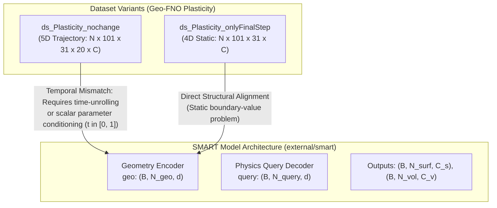
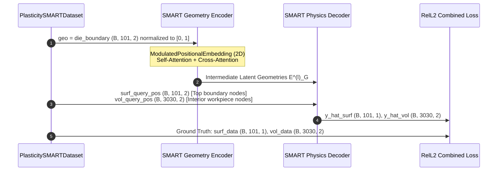

# Technical Study: Dataset Compatibility & Viability for SMART Model Training

This document provides a formal viability assessment and technical compatibility study for training the **SMART** (*Scalable Mesh-free Aerodynamic Simulations from Raw Geometries using a Transformer-based Surrogate Model*) model on the 2D Geo-FNO elastoplastic forging benchmark datasets:
- [`ds_Plasticity_nochange`](file:///home/arturobaltanas/University/Guided%20Research/data/processed/ds_plasticity_nochange/) (Full 5D dynamic trajectory)
- [`ds_Plasticity_onlyFinalStep`](file:///home/arturobaltanas/University/Guided%20Research/data/processed/ds_plasticity_onlyFinalStep/) (Static 4D final state)

---

## 1. Executive Summary & Core Findings



### Key Findings
1. **[`ds_Plasticity_onlyFinalStep`](file:///home/arturobaltanas/University/Guided%20Research/data/processed/ds_plasticity_onlyFinalStep/) has HIGH Viability (Direct Fit):**
   - The SMART architecture is explicitly constructed as a **steady-state / time-independent** PDE operator.
   - Posing the elastoplastic forging problem as a static boundary-value mapping—predicting final workpiece deformation and displacement fields directly from the rigid die geometry—aligns directly with SMART's encoder-decoder paradigm.
2. **[`ds_Plasticity_nochange`](file:///home/arturobaltanas/University/Guided%20Research/data/processed/ds_plasticity_nochange/) has LOW Out-of-the-Box Viability, MODERATE with Quasi-Static Adaptation:**
   - SMART possesses no autoregressive temporal roll-out loop, recurrent states, or sequential attention mechanisms.
   - To use `ds_Plasticity_nochange` without rewriting model internals, the 20-step trajectories must be unrolled into independent static pairs conditioned on normalized time $t \in [0, 1]$ via SMART's conditioning parameter vector (`parameter_channels = 1`).
3. **Four Concrete Structural Adaptations are Required for Both Datasets:**
   - **Spatial Dimension:** Configure `spatial_dim = 2` (SMART default is 3).
   - **Sampling Densities:** Downscale `latent_geometry_points` (default 4096) and `subsampled_geometry_points` (default 16384) to match the die contour size ($N = 101$).
   - **Surface/Volume Partition:** Reconcile SMART's hard assertion (`assert surface_channels > 0 and volume_channels > 0`) by partitioning boundary and continuum nodes.
   - **Coordinate Normalization:** Transform coordinates from physical millimeter ranges ($[-49.65, 0.35] \times [0, 15]$) into normalized bounding-box coordinates $[0, 1]$.

---

## 2. SMART Model Formal Input & Output Contract

The SMART model implementation is located at [`external/smart/smart/models/smart/smart.py`](file:///home/arturobaltanas/University/Guided%20Research/external/smart/smart/models/smart/smart.py). The training loop and loss interface are implemented in [`external/smart/smart/train.py`](file:///home/arturobaltanas/University/Guided%20Research/external/smart/smart/train.py) and [`external/smart/smart/loss/losses.py`](file:///home/arturobaltanas/University/Guided%20Research/external/smart/smart/loss/losses.py).

### 2.1 Model Forward Signature
```python
y_hat_surf, y_hat_vol = model(
    geo=geo_mesh,
    surf_query_pos=surf_mesh,
    vol_query_pos=vol_mesh,
    params=params
)
```

### 2.2 Input Specifications

| Input Argument | Tensor Shape | Dtype | Coordinate Domain / Range | Semantic Description in SMART |
| :--- | :--- | :--- | :--- | :--- |
| **`geo`** | `(B, N_geo, d)` | `torch.float32` | $[0, 1]$ (scaled internally by `pos_scale_factor = 1000`) | Point cloud of the boundary/obstacle geometry. Embedded via `ModulatedPositionalEmbedding` and compressed by the Geometry Encoder. |
| **`surf_query_pos`** | `(B, N_surf, d)` | `torch.float32` | $[0, 1]$ (scaled internally by `pos_scale_factor = 1000`) | Spatial query coordinates located on the surface boundary where surface physical fields are evaluated. |
| **`vol_query_pos`** | `(B, N_vol, d)` | `torch.float32` | $[0, 1]$ (scaled internally by `pos_scale_factor = 1000`) | Spatial query coordinates located within the domain volume where volumetric physical fields are evaluated. |
| **`params`** | `(B, d_param)` or `None` | `torch.float32` | Normalized or standardized scalars | Global scalar conditioning parameters (e.g., Reynolds/Mach number, angle of attack, or time step $t$). Pass `None` if `parameter_channels = 0`. |

Where:
- $B$: Batch size (e.g., 8, 16, 32).
- $d$: Spatial dimension (`spatial_dim`). SMART supports $d = 2$ or $d = 3$.
- $N_{\text{geo}}$: Number of input geometry points.
- $N_{\text{surf}}$: Number of surface query points.
- $N_{\text{vol}}$: Number of volume query points.
- $d_{\text{param}}$: Number of scalar parameters (`parameter_channels`).

### 2.3 Output Specifications

| Output Tensor | Tensor Shape | Dtype | Data Representation | Semantic Description in SMART |
| :--- | :--- | :--- | :--- | :--- |
| **`y_hat_surf`** | `(B, N_surf, C_surf)` | `torch.float32` | Standardized $(y - \mu) / \sigma$ | Predicted field values at `surf_query_pos` (e.g., surface pressure, wall shear stress, boundary contact force). |
| **`y_hat_vol`** | `(B, N_vol, C_vol)` | `torch.float32` | Standardized $(y - \mu) / \sigma$ | Predicted field values at `vol_query_pos` (e.g., velocity components, internal displacement field $(u_x, u_y)$). |

> [!IMPORTANT]
> **Architectural Constraint (`external/smart/smart/models/smart/smart.py#L467`):**
> SMART enforces `assert surface_channels > 0 and volume_channels > 0`. Therefore, the output cannot be solely volumetric or solely surface without adapting the constructor assertion or mapping at least 1 channel to surface and 1 to volume.

### 2.4 Loss Function Contract
SMART uses [`CombinedLoss`](file:///home/arturobaltanas/University/Guided%20Research/external/smart/smart/loss/losses.py#L31-L68) wrapping [`RelL2Loss`](file:///home/arturobaltanas/University/Guided%20Research/external/smart/smart/loss/losses.py#L4-L29):
$$\mathcal{L}_{\text{total}} = \text{RelL2}(y_{\text{hat\_surf}}, y_{\text{surf}}) + \text{RelL2}(y_{\text{hat\_vol}}, y_{\text{vol}})$$
where relative $L_2$ error is computed across spatial points:
$$\text{RelL2}(\hat{\mathbf{y}}, \mathbf{y}) = \frac{\|\hat{\mathbf{y}} - \mathbf{y}\|_2}{\|\mathbf{y}\|_2 + \epsilon}$$

---

## 3. Dataset Inventory & Dimensional Analysis

Both datasets were generated by the [`DatasetEngine`](file:///home/arturobaltanas/University/Guided%20Research/src/data/engine.py#L14-L100) pipeline from the raw ABAQUS simulation file `plas_N987_T20.mat`.

### 3.1 `ds_Plasticity_nochange` (Dynamic Trajectory Formulation)
Location: [`data/processed/ds_plasticity_nochange/`](file:///home/arturobaltanas/University/Guided%20Research/data/processed/ds_plasticity_nochange/)

| Field Key | Array Shape | Dtype | Value Range | Physical Description |
| :--- | :--- | :--- | :--- | :--- |
| `die_profile` | `(N, 101)` | `float32` | $[14.10, 26.10]$ | Vertical coordinate $S_d(x)$ of the top rigid die. |
| `die_boundary` | `(N, 101, 2)` | `float32` | $x \in [-49.65, 0.35]$, $y \in [14.10, 26.10]$ | Coordinate pairs $[x, S_d(x)]$ defining the die contour. |
| `coords_initial` | `(N, 101, 31, 2)` | `float32` | $x \in [-49.65, 0.35]$, $y \in [0.0, 14.91]$ | Undeformed reference mesh coordinates $\mathbf{X}_0$ at $t = 0$. |
| `coords` | `(N, 101, 31, 20, 2)` | `float32` | $x \in [-54.84, 15.06]$, $y \in [-0.10, 15.06]$ | Deformed spatial coordinates $\mathbf{x}(t)$ across 20 time steps. |
| `displacements`| `(N, 101, 31, 20, 2)` | `float32` | $u_x \in [-5.20, 5.73]$, $u_y \in [-6.51, 0.91]$ | Displacement fields $\mathbf{u}(t) = \mathbf{x}(t) - \mathbf{X}_0$. |
| `target_all` | `(N, 101, 31, 20, 4)` | `float32` | $[-54.84, 15.06]$ | Concatenated targets: $[x(t), y(t), u_x(t), u_y(t)]$. |
| `time_steps` | `(20,)` | `float32` | $[0.0, 1.0]$ | Normalized physical time increments $t_k = k / 19$. |

Partitions: Train = 900 samples, Val = 7 samples, Test = 80 samples.

### 3.2 `ds_Plasticity_onlyFinalStep` (Static Steady-State Formulation)
Location: [`data/processed/ds_plasticity_onlyFinalStep/`](file:///home/arturobaltanas/University/Guided%20Research/data/processed/ds_plasticity_onlyFinalStep/)

| Field Key | Array Shape | Dtype | Value Range | Physical Description |
| :--- | :--- | :--- | :--- | :--- |
| `die_boundary` | `(N, 101, 2)` | `float32` | $x \in [-49.65, 0.35]$, $y \in [14.10, 26.10]$ | Coordinate pairs $[x, S_d(x)]$ of the die contour. |
| `coords_initial` | `(N, 101, 31, 2)` | `float64` | $x \in [-49.65, 0.35]$, $y \in [0.0, 14.91]$ | Undeformed reference mesh coordinates $\mathbf{X}_0$. |
| `coords` | `(N, 101, 31, 2)` | `float64` | $x \in [-54.84, 15.06]$, $y \in [-0.10, 15.06]$ | Final deformed configuration at $t = t_{\text{final}}$. |
| `displacements`| `(N, 101, 31, 2)` | `float64` | $u_x \in [-5.20, 5.73]$, $u_y \in [-6.51, 0.91]$ | Final cumulative displacement field $(u_x, u_y)$. |
| `target_all` | `(N, 101, 31, 4)` | `float64` | $[-54.84, 15.06]$ | All 4 solution channels at final increment. |

---

## 4. Gap Analysis & Compatibility Assessment

| Aspect | SMART Requirement | `ds_Plasticity_nochange` | `ds_Plasticity_onlyFinalStep` | Gap / Required Action |
| :--- | :--- | :--- | :--- | :--- |
| **Temporal Nature** | Purely static / time-independent operator $\mathcal{G}: \Omega_{\text{geo}} \to \mathbf{u}$ | 5D Trajectory ($T = 20$ timesteps) | Static 4D final state ($T$ dropped) | `nochange` requires unrolling timesteps as parameter-conditioned samples. `onlyFinalStep` matches directly. |
| **Spatial Dimension** | Parameterized by `spatial_dim` (defaults to 3 in CFD scripts) | 2D ($x, y$) | 2D ($x, y$) | Must pass `spatial_dim=2` when instantiating SMART. |
| **Geometry Points** | Default `latent_geometry_points=4096`, `subsampled_geometry_points=16384` | `die_boundary` has 101 points | `die_boundary` has 101 points | Setting defaults directly causes IndexError/undersampling. Must lower to $N_{\text{geo}} \le 101$ or upsample geometry. |
| **Surface/Volume Channels** | Both `surface_channels > 0` and `volume_channels > 0` | All nodes in $(101, 31)$ domain | All nodes in $(101, 31)$ domain | Must partition workpiece into boundary nodes (surface) and interior nodes (volume), or use adapter dummy channel. |
| **Coordinate Normalization** | Positions must be in $[0, 1]$ before `pos_scale_factor` | Physical mm: $x \in [-49.65, 0.35]$, $y \in [0, 26.1]$ | Physical mm: $x \in [-49.65, 0.35]$, $y \in [0, 26.1]$ | Must apply min-max coordinate scaling to $[0, 1]$ via unified bounding box. |
| **Data Types** | `torch.float32` | `float32` (train.npz) | `float64` (train.npz) | `onlyFinalStep` arrays must be cast to `float32` during loading. |

---

## 5. Technical Approaches for SMART Model Training

### Approach 1: Static End-State Surrogate with `ds_Plasticity_onlyFinalStep` (Recommended Baseline)

In this approach, SMART is configured to predict the cumulative elastoplastic deformation at the final stroke of the die.



#### Mapping Specification
1. **Geometry Input (`geo`):**
   - Source: `die_boundary` with shape `(B, 101, 2)`.
   - Normalization:
     $$\mathbf{x}_{\text{norm}} = \frac{\mathbf{x} - \mathbf{x}_{\min}}{\mathbf{x}_{\max} - \mathbf{x}_{\min}} \in [0, 1]^2$$
     using global bounding box $x \in [-50.0, 1.0]$, $y \in [0.0, 27.0]$.
2. **Surface Query (`surf_query_pos`) & Target (`surf_data`):**
   - Source: Top boundary of workpiece at undeformed height $Y_0 \approx 15.0$ mm (`coords_initial[:, :, -1, :]`), shape `(B, 101, 2)`.
   - Query Coordinates: Normalized initial positions $\mathbf{X}_{0, \text{surf}} \in [0, 1]^2$.
   - Target (`surf_data`): Vertical displacement $u_y$ or resultant displacement magnitude $\sqrt{u_x^2 + u_y^2}$, standardized via $(y - \mu) / \sigma$, shape `(B, 101, 1)` $\implies \mathbf{surface\_channels = 1}$.
3. **Volume Query (`vol_query_pos`) & Target (`vol_data`):**
   - Source: Remaining $101 \times 30 = 3030$ continuum nodes (`coords_initial[:, :, :-1, :]`), flattened to `(B, 3030, 2)`.
   - Query Coordinates: Normalized initial positions $\mathbf{X}_{0, \text{vol}} \in [0, 1]^2$.
   - Target (`vol_data`): 2D displacement vectors $(u_x, u_y)$, standardized per channel via $(y_c - \mu_c) / \sigma_c$, shape `(B, 3030, 2)` $\implies \mathbf{volume\_channels = 2}$.
4. **Conditioning Parameters (`params`):**
   - `params = None` with `parameter_channels = 0`.

#### Model Hyperparameter Overrides
To match the plasticity dataset scale, configure SMART in Hydra:
```yaml
architecture:
  spatial_dim: 2
  surface_channels: 1
  volume_channels: 2
  parameter_channels: 0
  latent_dim: 128
  latent_geometry_points: 64
  subsampled_geometry_points: 101
  num_encoder_decoder_blocks: 6
  num_heads: 8
  pos_scale_factor: 1000.0
```

---

### Approach 2: Quasi-Static Time-Conditioned Surrogate with `ds_Plasticity_nochange`

To train on the full temporal dataset, the 20-step trajectories are reformulated as parameter-conditioned static instances.

#### Mathematical Formulation
$$\mathcal{G}_\theta : (\text{die\_boundary}, \mathbf{X}_0, t) \longrightarrow \mathbf{u}(\mathbf{X}_0, t), \quad t \in [0.0, 1.0]$$

#### Unrolling Transformation
- Raw samples: $N = 900$ simulation runs.
- Trajectory length: $T = 20$ time increments.
- Total effective dataset size: $N \times T = 900 \times 20 = 18,000$ training pairs.
- Conditioning Parameter: For each pair $(i, k)$, pass normalized time $t_k = \text{time\_steps}[k] \in [0, 1]$ as `params` of shape `(B, 1)` with `parameter_channels = 1`.

#### SMART Modulation Mechanism
In [`external/smart/smart/models/smart/smart.py#L394-L398`](file:///home/arturobaltanas/University/Guided%20Research/external/smart/smart/models/smart/smart.py#L394-L398), when `parameter_channels > 0`, SMART activates `SimulationParamModulatedMLP`:
$$\mathbf{h}' = \mathbf{h} \odot \gamma(t) + \beta(t)$$
This modulates the intermediate latent geometry tokens based on the current load step $t$, allowing the decoder to predict progressive plastic flow throughout the forging process.

---

### Approach 3: Simultaneous Multi-Step Trajectory Prediction

Instead of conditioning on time scalar $t$, stack all 20 time steps directly into the output channels:
- Input: `die_boundary` `(B, 101, 2)`.
- Query Positions: $\mathbf{X}_0 \in \mathbb{R}^{B \times 3131 \times 2}$.
- Surface Channels: $20 \times 1 = 20$ (boundary vertical displacements over time).
- Volume Channels: $20 \times 2 = 40$ (continuum displacement field $(u_x, u_y)$ over all 20 time steps).
- Advantage: Single forward pass infers the full forging history.
- Limitation: Fixed temporal grid; cannot evaluate arbitrary intermediate continuous times.

---

## 6. Production-Ready PyTorch Dataset Adapter

The following complete adapter implements **Approach 1**, directly converting [`data/processed/ds_plasticity_onlyFinalStep/`](file:///home/arturobaltanas/University/Guided%20Research/data/processed/ds_plasticity_onlyFinalStep/) into the exact tuple format expected by SMART:

```python
"""PyTorch Dataset Adapter bridging processed plasticity datasets to the SMART model."""

from pathlib import Path
from typing import Dict, Tuple

import numpy as np
import torch
from torch.utils.data import Dataset


class PlasticitySMARTDataset(Dataset):
    """PyTorch Dataset adapter for training SMART on 2D elastoplastic forging data.
    
    Transforms processed .npz partitions into SMART's expected forward-pass tuple:
    (geo_mesh, surf_mesh, surf_data, vol_mesh, vol_data)
    """

    def __init__(
        self,
        npz_path: Path,
        stats_dict: Dict[str, Dict[str, float]],
        subsample_geo: int = 101,
    ) -> None:
        """Initialize dataset adapter and pre-normalize coordinates.

        Parameters
        ----------
        npz_path : Path
            Path to train.npz, val.npz, or test.npz.
        stats_dict : Dict[str, Dict[str, float]]
            Normalization moments containing mean and std for target fields.
        subsample_geo : int
            Number of geometry points to sample (default: 101).
        """
        data = np.load(npz_path)

        # Die boundary geometry: (N, 101, 2)
        raw_die: np.ndarray = data["die_boundary"].astype(np.float32)
        # Reference coordinates: (N, 101, 31, 2)
        raw_x0: np.ndarray = data["coords_initial"].astype(np.float32)
        # Target displacements: (N, 101, 31, 2)
        raw_u: np.ndarray = data["displacements"].astype(np.float32)

        num_samples, nx, ny, _ = raw_x0.shape

        # Global bounding box for coordinate normalization into [0, 1]
        self.min_pos = np.array([-50.0, 0.0], dtype=np.float32)
        self.max_pos = np.array([1.0, 27.0], dtype=np.float32)
        pos_span = self.max_pos - self.min_pos

        # 1. Geometry mesh (die boundary): (N, 101, 2)
        self.geo_mesh = (raw_die - self.min_pos) / pos_span

        # 2. Surface partition: Top boundary workpiece nodes (y = 15mm)
        # raw_x0[:, :, -1, :] has shape (N, 101, 2)
        surf_x0 = raw_x0[:, :, -1, :].copy()
        self.surf_mesh = (surf_x0 - self.min_pos) / pos_span

        # Surface target: Vertical displacement u_y (N, 101, 1)
        raw_surf_u = raw_u[:, :, -1, 1:2].copy()
        u_y_mean = float(stats_dict["displacements"]["per_channel"]["mean"][1])
        u_y_std = float(stats_dict["displacements"]["per_channel"]["std"][1])
        self.surf_data = (raw_surf_u - u_y_mean) / (u_y_std + 1e-8)

        # 3. Volume partition: Interior workpiece nodes
        # raw_x0[:, :, :-1, :] has shape (N, 101, 30, 2) -> flatten to (N, 3030, 2)
        vol_x0 = raw_x0[:, :, :-1, :].reshape(num_samples, -1, 2).copy()
        self.vol_mesh = (vol_x0 - self.min_pos) / pos_span

        # Volume target: Full 2D displacements (u_x, u_y) flattened to (N, 3030, 2)
        raw_vol_u = raw_u[:, :, :-1, :].reshape(num_samples, -1, 2).copy()
        u_mean = np.array(stats_dict["displacements"]["per_channel"]["mean"], dtype=np.float32)
        u_std = np.array(stats_dict["displacements"]["per_channel"]["std"], dtype=np.float32)
        self.vol_data = (raw_vol_u - u_mean) / (u_std + 1e-8)

        self.num_samples = num_samples
        self.subsample_geo = subsample_geo

    def __len__(self) -> int:
        """Return total number of simulation samples."""
        return self.num_samples

    def __getitem__(
        self, idx: int
    ) -> Tuple[torch.Tensor, torch.Tensor, torch.Tensor, torch.Tensor, torch.Tensor]:
        """Retrieve preprocessed sample formatted for SMART forward pass.

        Returns
        -------
        Tuple[torch.Tensor, torch.Tensor, torch.Tensor, torch.Tensor, torch.Tensor]
            geo_mesh: (N_geo, 2)
            surf_mesh: (101, 2)
            surf_data: (101, 1)
            vol_mesh: (3030, 2)
            vol_data: (3030, 2)
        """
        geo = torch.from_numpy(self.geo_mesh[idx])
        surf_m = torch.from_numpy(self.surf_mesh[idx])
        surf_d = torch.from_numpy(self.surf_data[idx])
        vol_m = torch.from_numpy(self.vol_mesh[idx])
        vol_d = torch.from_numpy(self.vol_data[idx])

        return geo, surf_m, surf_d, vol_m, vol_d
```

---

## 7. Action Plan for Milestone 1 Execution

1. **Step 1: Save Dataset Adapter:** Place `PlasticitySMARTDataset` into [`src/data/adapters.py`](file:///home/arturobaltanas/University/Guided%20Research/src/data/).
2. **Step 2: Register in SMART Dataset Registry:** Add `"Plasticity"` key to `datasets` dictionary in [`external/smart/smart/data/datasets.py`](file:///home/arturobaltanas/University/Guided%20Research/external/smart/smart/data/datasets.py#L8-L13).
3. **Step 3: Define Experiment Configuration:** Create `configs/plasticity_smart.yaml` with `spatial_dim=2`, `surface_channels=1`, and `volume_channels=2`.
4. **Step 4: Execute Baseline Training:** Launch training via `scripts/train_smart_baseline.py` using [`data/processed/ds_plasticity_onlyFinalStep/`](file:///home/arturobaltanas/University/Guided%20Research/data/processed/ds_plasticity_onlyFinalStep/) and evaluate Relative $L_2$ errors against literature benchmarks.
