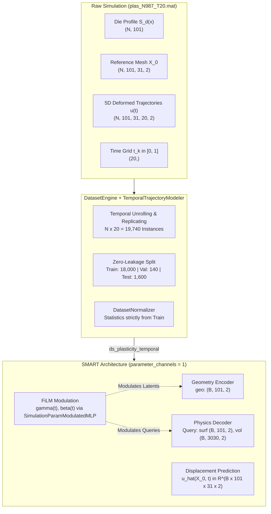

# Scientific & Technical Study: Time-Conditioned SMART Surrogate for Elastoplastic Trajectories

This document details the architectural formulation, mathematical foundation, dataset pipeline, and implementation of the **Time-Conditioned Continuous Surrogate Model** for 2D elastoplastic forging simulations using the **SMART** (*Scalable Mesh-free Aerodynamic Simulations from Raw Geometries using a Transformer-based Surrogate Model*) architecture.

---

## 1. Executive Summary & Problem Motivation

### 1.1 The Limitation of the Baseline Formulation (`ds_plasticity_onlyFinalStep`)
In the initial baseline approach ([`data/processed/ds_plasticity_onlyFinalStep/`](file:///home/arturo/GuidedResearch/TransformerSurrogatesPDEs-GuidedResearch/data/processed/ds_plasticity_onlyFinalStep/)), the dataset was modeled by isolating only the final time increment ($t_{\text{final}} = t_{-1} = 1.0$) via `ConsiderOnlyFinalStepModeler`. 

While this allowed a straightforward static mapping from die geometry to cumulative deformation, it suffered from two major scientific shortcomings:
1. **Severe Data Inefficiency (95% Information Loss):** The raw ABAQUS numerical simulation files contain $20$ temporal increments per run ($t_0, t_1, \dots, t_{19}$). Retaining solely the last step discarded $19$ out of $20$ physical deformation states ($17,100$ simulation snapshots across $900$ training runs).
2. **Inability to Predict Deformation Dynamics:** Real-world metal forming and manufacturing require continuous monitoring of yield inception, plastic zone propagation, and punch reaction forces throughout the entire stroke—not merely post-forging inspection.

### 1.2 The New Approach: Time-Conditioned Continuous Operator
Instead of collapsing trajectories into a single static frame, the new approach utilizes the full temporal sequence by posing the learning task as a **parameter-conditioned continuous operator**:



---

## 2. Mathematical Formulation

Let $\Omega_0 \subset \mathbb{R}^2$ represent the undeformed rectangular workpiece domain discretized by initial node coordinates $\mathbf{X}_0 \in \mathbb{R}^{101 \times 31 \times 2}$. Let $\Gamma_{\text{die}} \subset \mathbb{R}^2$ denote the 1D rigid die punch profile parameterized by horizontal coordinates $x \in [-49.65, 0.35]$ mm and vertical contour heights $S_d(x)$.

The forging process is governed by quasi-static elastoplastic solid mechanics under displacement-controlled indentation. The normalized time parameter $t \in [0.0, 1.0]$ corresponds linearly to the punch penetration stroke:
$$\Delta y_{\text{punch}}(t) = t \cdot \Delta y_{\max}$$

The surrogate model learns the infinite-dimensional non-linear mapping:
$$\mathcal{G}_\theta : \left( \Gamma_{\text{die}}, \mathbf{X}_0, t \right) \longmapsto \mathbf{u}(\mathbf{X}_0, t) = \begin{bmatrix} u_x(\mathbf{X}_0, t) \\ u_y(\mathbf{X}_0, t) \end{bmatrix}$$

subject to:
1. **Initial Boundary Condition:** $\mathbf{u}(\mathbf{X}_0, 0) = \mathbf{0}$.
2. **Bottom Boundary Clamping:** $\mathbf{u}(x, y_{\min}, t) = \mathbf{0}$ (fixed anvil support).
3. **Contact Non-Penetration Condition:** $y_{\text{workpiece}}(x, t) \le S_d(x) - \Delta y_{\text{punch}}(t)$ on the contact boundary.

---

## 3. Architecture & Parameter Modulation Mechanics

### 3.1 SMART FiLM Conditioning (`parameter_channels = 1`)
The SMART model was natively constructed for parameterized steady-state operators (e.g., varying Reynolds/Mach numbers in aerodynamics). In [`external/smart/smart/models/smart/smart.py`](file:///home/arturo/GuidedResearch/TransformerSurrogatesPDEs-GuidedResearch/external/smart/smart/models/smart/smart.py), setting `parameter_channels = 1` activates the `SimulationParamModulatedMLP` subsystem:

```python
class Modulation(nn.Module):
    def __init__(self, dim, cond_dim, hidden_dim=128):
        super().__init__()
        self.mlp = nn.Sequential(
            nn.Linear(cond_dim, hidden_dim),
            nn.GELU(),
            nn.Linear(hidden_dim, dim * 2)
        )

    def forward(self, x, params):
        scale, shift = torch.tensor_split(self.mlp(params), 2, dim=-1)
        return scale * x + shift
```

In every encoder block and every decoder block, the latent geometry tokens $\mathbf{E}_G^{(l)}$ and physics query tokens $\mathbf{Q}^{(l)}$ undergo adaptive affine transformation conditioned on time $t$:
$$\mathbf{h}' = \mathbf{h} \odot \left(1 + \boldsymbol{\gamma}(t)\right) + \boldsymbol{\beta}(t)$$

### 3.2 Non-Invasive Spatial Broadcasting Solution
SMART's internal `Modulation.forward(x, params)` module evaluates `scale * x + shift`. When features $\mathbf{x} \in \mathbb{R}^{B \times N \times d}$ have spatial length $N = 3,131$ and conditioning parameters $\mathbf{p} \in \mathbb{R}^{B \times 1}$ are 2D, PyTorch tensor multiplication raises a dimensional mismatch (`size of tensor a (B) must match size of tensor b (N) at non-singleton dimension 1`).

To adhere strictly to the rule prohibiting direct edits inside `external/` submodules, the adapter [`SMARTModelWrapper`](file:///home/arturo/GuidedResearch/TransformerSurrogatesPDEs-GuidedResearch/src/training/wrappers/smart_wrapper.py#L91-L105) intercepts incoming batches and unsqueezes the parameter tensor to 3D:
$$\mathbf{p} \in \mathbb{R}^{B \times 1} \xrightarrow{\quad \text{unsqueeze(1)} \quad} \mathbf{p} \in \mathbb{R}^{B \times 1 \times 1}$$
This broadcasts along spatial dimension $N$ at zero memory cost, preserving complete compatibility with SMART's internal PyTorch layers.

---

## 4. Dataset Preprocessing Pipeline (`ds_plasticity_temporal`)

The dataset preprocessing pipeline is orchestrated by [`DatasetEngine`](file:///home/arturo/GuidedResearch/TransformerSurrogatesPDEs-GuidedResearch/src/data/engine.py), utilizing the new [`TemporalTrajectoryModeler`](file:///home/arturo/GuidedResearch/TransformerSurrogatesPDEs-GuidedResearch/src/data/modelers.py#L84-L188):

### 4.1 In-Memory Tensor Transformation
1. **Kinematic Unrolling:** The 5D tensors from `PlasticitySetup` are reshaped along the sample dimension:
   $$\text{coords}: (N, 101, 31, 20, 2) \xrightarrow{\quad \text{transpose(0, 3, 1, 2, 4).reshape} \quad} (N \times 20, 101, 31, 2)$$
   $$\text{displacements}: (N, 101, 31, 20, 2) \xrightarrow{\quad \text{transpose(0, 3, 1, 2, 4).reshape} \quad} (N \times 20, 101, 31, 2)$$
2. **Invariant Feature Replication:** Spatial inputs that do not vary with time (`die_boundary`, `coords_initial`) are tiled across the temporal dimension:
   $$\text{die\_boundary}: (N, 101, 2) \xrightarrow{\quad \text{np.repeat}(\dots, 20, \text{axis}=0) \quad} (N \times 20, 101, 2)$$
   $$\text{coords\_initial}: (N, 101, 31, 2) \xrightarrow{\quad \text{np.repeat}(\dots, 20, \text{axis}=0) \quad} (N \times 20, 101, 31, 2)$$
3. **Explicit Parameter Tensor:** Generates normalized time tensor $\mathbf{t} \in \mathbb{R}^{(N \times 20) \times 1}$ with $t \in [0.0, 1.0]$.
4. **Trajectory Lineage Tracking:** Stores `simulation_idx` $\in [0, N-1]$ and `time_step_idx` $\in [0, 19]$ to allow downstream scripts to reconstruct continuous trajectories or isolate specific increments (such as $t=1.0$).

### 4.2 Zero Data-Leakage Partitioning
The splitting strategy [`DatasetSplitter`](file:///home/arturo/GuidedResearch/TransformerSurrogatesPDEs-GuidedResearch/src/data/splitter.py) partitions contiguous simulation blocks:
- **Train Partition (900 simulations $\times$ 20 steps = 18,000 instances):** Simulations $0 \le i < 900$.
- **Validation Partition (7 simulations $\times$ 20 steps = 140 instances):** Simulations $900 \le i < 907$.
- **Test Partition (80 simulations $\times$ 20 steps = 1,600 instances):** Simulations $907 \le i < 987$.

All 20 time steps of any simulation stay strictly within that simulation's assigned partition. Test simulations are 100% unobserved during training and normalization.

---

## 5. Folder Structure & Placement Standards

In adherence to project architectural guidelines, all components and artifacts follow a standardized directory hierarchy:

```text
TransformerSurrogatesPDEs-GuidedResearch/
├── data/
│   ├── raw/
│   │   └── plasticity-V1/plasticity/plas_N987_T20.mat       <- Source simulation file
│   └── processed/
│       ├── ds_plasticity_onlyFinalStep/                      <- Static baseline (t = -1)
│       └── ds_plasticity_temporal/                          <- New continuous trajectory dataset
│           ├── train.npz                                     <- 18,000 unrolled training pairs (2.89 GB)
│           ├── val.npz                                       <- 140 validation pairs (22.7 MB)
│           ├── test.npz                                      <- 1,600 test pairs (257.8 MB)
│           └── statistical_data.json                         <- Mean/std computed strictly from train
├── models/
│   ├── smart_experiment_1/                                   <- Baseline (50 epochs, onlyFinalStep)
│   ├── smart_experiment_2/                                   <- Baseline (200 epochs, onlyFinalStep)
│   └── smart_temporal_experiment_1/                          <- Time-conditioned SMART run
│       ├── best_model.pt                                     <- Optimal checkpoint
│       ├── latest.pt                                         <- Checkpoint of most recent epoch
│       └── training_metrics.jsonl                            <- JSONL epoch telemetry log
├── results/
│   └── TrainingAnalysis/
│       ├── ds_plasticity_onlyFinalStep/                      <- Baseline training analyses
│       └── ds_plasticity_temporal/                           <- New approach training analysis
│           └── SMART/
│               └── epochs_10_batch_32_lr_1e-4/
│                   └── smart_temporal_experiment_1/
│                       ├── training_curves.png               <- 4-panel KPI telemetry visualization
│                       ├── training_history.csv              <- Epoch metrics CSV
│                       ├── evaluation_summary.md             <- Scientific benchmark report
│                       ├── evaluation_metrics.json           <- Machine-readable metric record
│                       └── evaluation_contours.png           <- Deformed mesh contour error plots
├── scripts/
│   ├── preprocess_dataset.py                                 <- CLI runner with --temporal flag
│   ├── train_smart_temporal.py                               <- Dedicated time-conditioned training runner
│   └── evaluate_model.py                                     <- EvaluationEngine runner (auto-detects time_params)
├── src/
│   ├── data/
│   │   └── modelers.py                                       <- Holds TemporalTrajectoryModeler
│   └── training/
│       ├── batch_loaders.py                                  <- SMARTBatchLoader with time_params packing
│       └── wrappers/smart_wrapper.py                         <- SMARTModelWrapper with 3D params handling
└── doc/
    └── studies/
        └── temporal_trajectory_smart_approach.md             <- This technical document
```

---

## 6. Training Configuration & Comparative Benchmark Plan

### 6.1 Hyperparameter Specifications
- **Optimizer:** AdamW (`weight_decay = 1e-4`)
- **Initial Learning Rate:** $1.0 \times 10^{-4}$
- **LR Scheduler:** Cosine Annealing (`eta_min = 1.0e-6`)
- **Loss Engine:** Relative $L_2$ Loss ($\text{Rel } L_2 = \|\hat{\mathbf{u}} - \mathbf{u}\|_2 / (\|\mathbf{u}\|_2 + 10^{-7})$)
- **Batch Size:** $32$ ($563$ batches per epoch)
- **Gradient Clipping:** Maximum gradient norm threshold $1.0$

### 6.2 Comparison Matrix: Static Baseline vs. Temporal Surrogate

| Attribute | Baseline (`smart_experiment_1`) | Baseline (`smart_experiment_2`) | New Approach (`smart_temporal_experiment_1`) |
| :--- | :--- | :--- | :--- |
| **Dataset Path** | `ds_plasticity_onlyFinalStep` | `ds_plasticity_onlyFinalStep` | `ds_plasticity_temporal` |
| **Temporal Coverage** | Final step only ($t = 1.0$) | Final step only ($t = 1.0$) | Continuous ($t \in [0.0, 1.0]$, 20 steps) |
| **Training Samples** | $900$ | $900$ | $18,000$ |
| **Epochs** | $50$ | $200$ | $10$ |
| **Gradient Updates** | $2,800$ updates | $11,200$ updates | $5,630$ updates |
| **Parameter Channels**| $0$ | $0$ | **$1$ (Time $t$)** |
| **FiLM Modulation** | Disabled | Disabled | **Active (Encoder & Decoder blocks)** |
| **Inference Scope** | Only predicts final stroke | Only predicts final stroke | **Predicts deformation at arbitrary $t \in [0, 1]$** |
