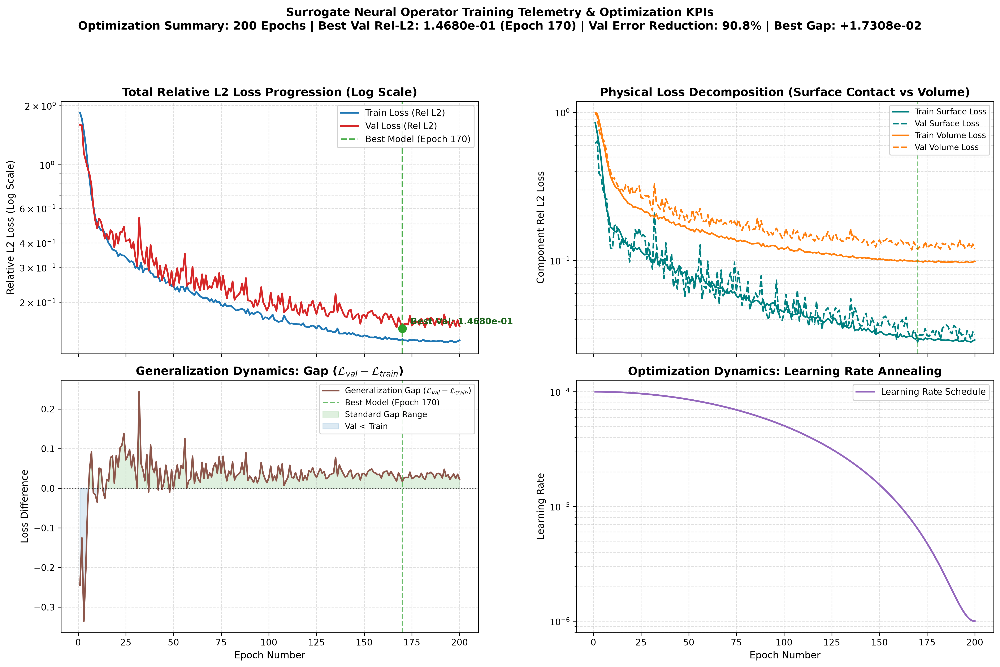
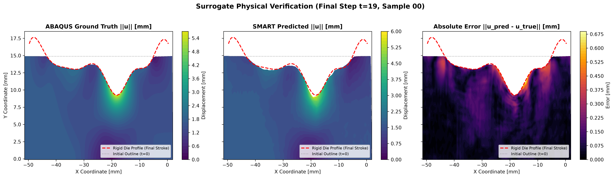

# Surrogate Benchmark Evaluation Report

**Checkpoint:** `models/smart_experiment_2/best_model.pt`

---

### 1. Physical Accuracy Metrics (Real Physical Units: mm)
| Metric | Value | Reference Standard | Assessment |
| :--- | :--- | :--- | :--- |
| **Overall Relative L2 Error** | **9.11%** | < 5.0% | Adequate |
| **Surface Contact L2 Error** | **4.59%** | < 6.0% | Strong Contact Adherence |
| **Volume Interior L2 Error** | **9.18%** | < 5.0% | Moderate |
| **Maximum Pointwise Error (L_inf)** | **2.159 mm** | Peak displacement: ~6.5 mm | Peak localized deviation |
| **Sobolev H1 Semi-Norm Error** | **43.50%** | < 10.0% | Strain gradient fidelity |

---

### 2. Solid Mechanics Feasibility (Die Non-Penetration Constraint)
| Metric | Value | Constraint Threshold | Status |
| :--- | :--- | :--- | :--- |
| **Max Die Penetration Depth** | **0.0000 mm** | < 0.05 mm | **PASS** |
| **Mean Die Penetration** | **0.0000 mm** | < 0.01 mm | **PASS** |
| **Contact Violation Rate** | **0.0%** of boundary nodes | < 5.0% | **PASS** |

---

### 3. Computational Performance vs. Numerical Solver (ABAQUS FEM)
| Hardware / Execution Metric | Evaluated Value |
| :--- | :--- |
| **Inference Latency per Sample** | **3.02 ms** |
| **Peak GPU VRAM Allocation** | **272.4 MB** |
| **Trainable Parameters** | **1,812,932** |
| **Abaqus FEM Solver Runtime** | ~120.0 seconds / simulation |
| **Surrogate Speedup Factor** | **39,779x Faster** |

---

### 4. Training Convergence & Optimization KPIs
| Training Metric / KPI | Value | Reference / Status |
| :--- | :--- | :--- |
| **Total Completed Epochs** | **200** | Full training schedule executed |
| **Optimal Checkpoint Epoch** | **Epoch 170** | Lowest validation error checkpoint |
| **Initial Total Loss (Epoch 1)** | **1.5948e+00** (Train: 1.8387e+00) | Optimization starting point |
| **Optimal Validation Loss** | **1.4680e-01** | **90.8% Total Reduction** |
| **Final Epoch Total Loss** | Train: **1.2788e-01** | Val: **1.5075e-01** | Terminal training state |
| **Surface Contact Loss (Best)** | Train: **3.0041e-02** | Val: **2.8076e-02** | Boundary contact adherence |
| **Volume Interior Loss (Best)** | Train: **9.9455e-02** | Val: **1.1873e-01** | Continuum deformation fidelity |
| **Generalization Gap (Val - Train)** | **+1.7308e-02** | Generalization error spread |
| **Learning Rate Transition** | **1.00e-04 -> 1.00e-06** | Scheduled annealing |
| **Convergence Assessment** | **Strong Convergence (90.8% Error Drop, Peak at Epoch 170)** | Solid mechanics surrogate stability |

---

### 5. Benchmark Visualizations

#### A. Training Convergence Curves & Error per Epoch

#### B. Deformed Mesh & Physical Displacement Verification Contours

