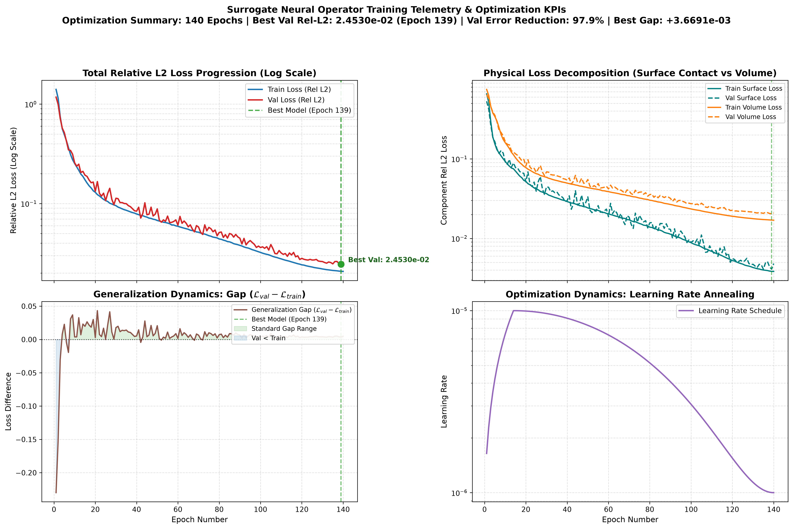
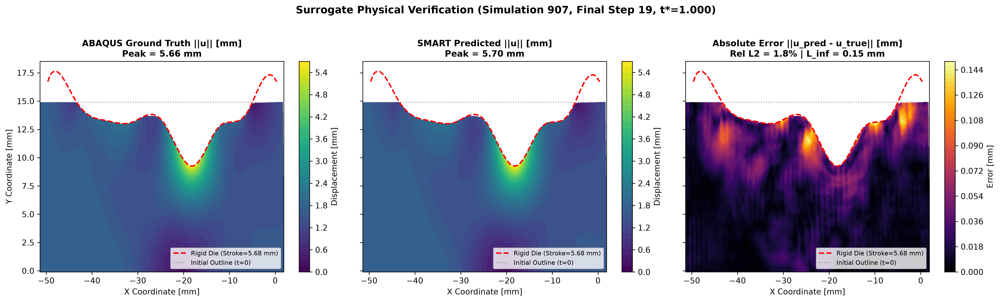
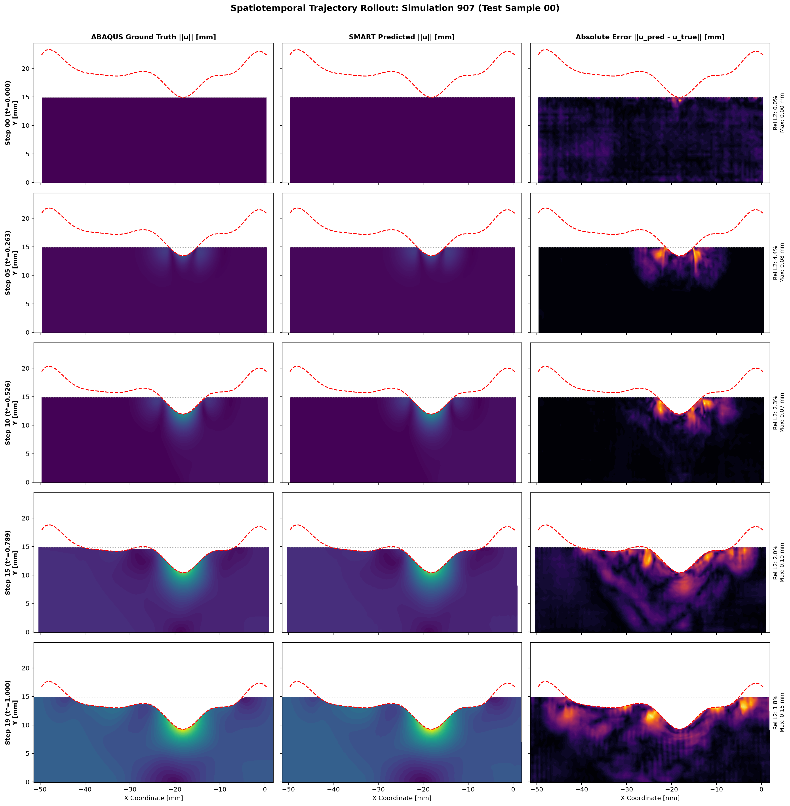
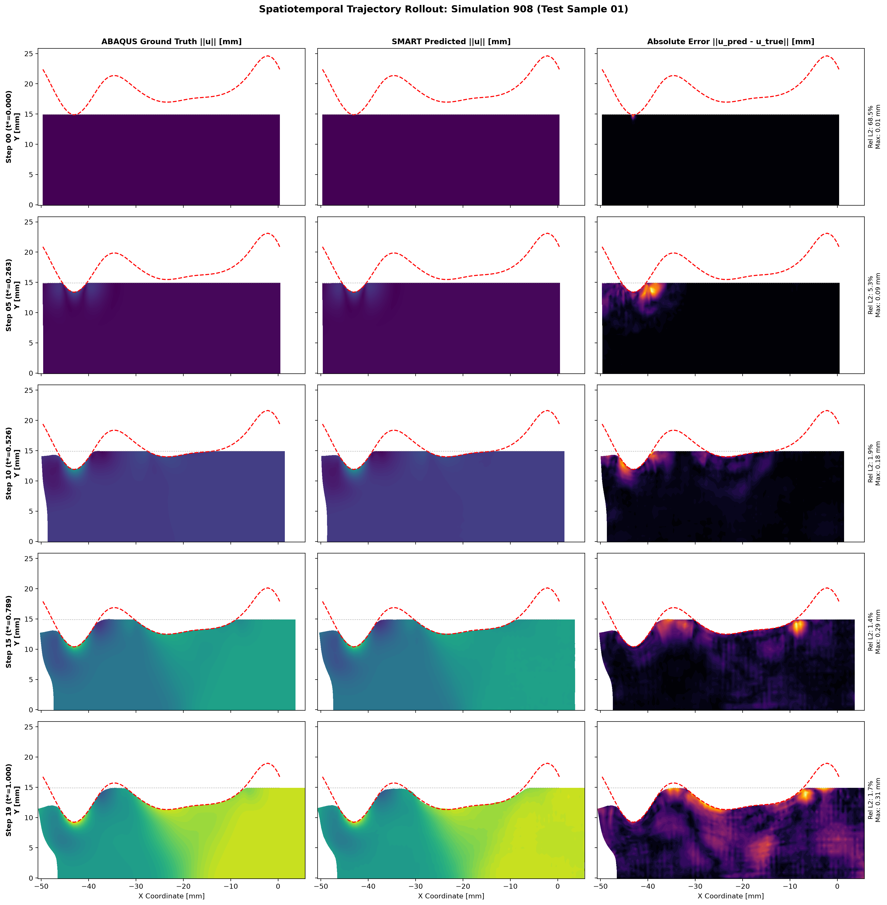
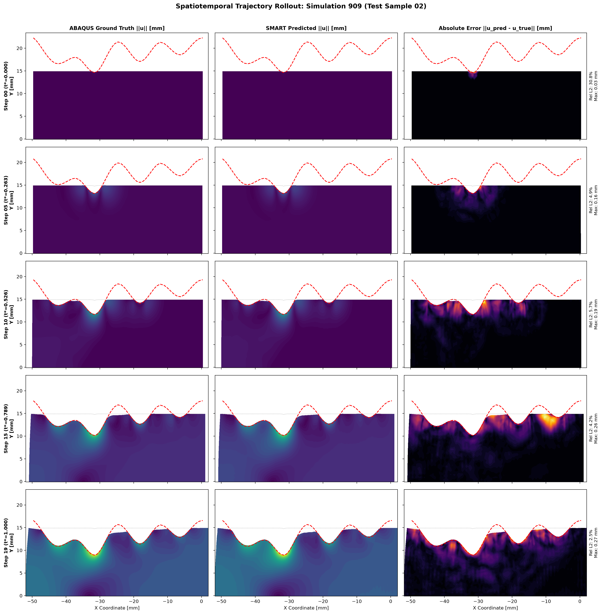
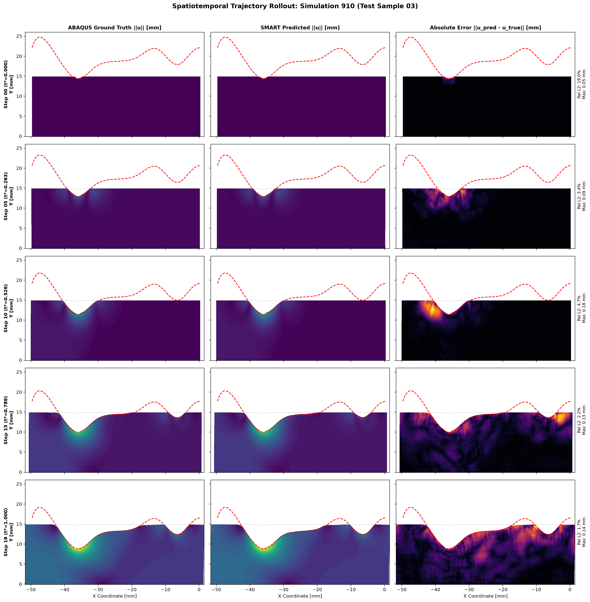

# Surrogate Benchmark Evaluation Report

**Checkpoint:** `models/LION/batch_size_4_fp32_ep140_lr1e5/best_model.pt`

---

### 1. Physical Accuracy Metrics (Real Physical Units: mm)
| Metric | Value | Reference Standard | Assessment |
| :--- | :--- | :--- | :--- |
| **Pure Displacement Relative L2 Error** | **5.02%** | < 5.0% | Adequate |
| **Joint 4-Channel Relative L2 Error (Literature)** | **0.10%** | < 1.0% | Excellent |
| **Surface Contact L2 Error** | **4.96%** | < 6.0% | Strong Contact Adherence |
| **Volume Interior L2 Error** | **5.01%** | < 5.0% | Moderate |
| **Maximum Pointwise Error (L_inf)** | **0.560 mm** | Peak displacement: ~6.5 mm | Peak localized deviation |
| **Sobolev H1 Semi-Norm Error** | **12.91%** | < 10.0% | Strain gradient fidelity |

---

### 2. Solid Mechanics Feasibility (Die Non-Penetration Constraint)
| Metric | Value | Constraint Threshold | Status |
| :--- | :--- | :--- | :--- |
| **Max Die Penetration Depth** | **0.0011 mm** | < 0.05 mm | **PASS** |
| **Mean Die Penetration** | **0.0011 mm** | < 0.01 mm | **PASS** |
| **Contact Violation Rate** | **0.0%** of boundary nodes | < 5.0% | **PASS** |

---

### 3. Computational Performance vs. Numerical Solver (ABAQUS FEM)
| Hardware / Execution Metric | Evaluated Value |
| :--- | :--- |
| **Inference Latency per Sample** | **10.48 ms** |
| **Peak GPU VRAM Allocation** | **1540.4 MB** |
| **Trainable Parameters** | **11,380,676** |
| **Abaqus FEM Solver Runtime** | ~120.0 seconds / simulation |
| **Surrogate Speedup Factor** | **11,445x Faster** |

---

### 4. Training Convergence & Optimization KPIs
| Training Metric / KPI | Value | Reference / Status |
| :--- | :--- | :--- |
| **Total Completed Epochs** | **140** | Full training schedule executed |
| **Optimal Checkpoint Epoch** | **Epoch 139** | Lowest validation error checkpoint |
| **Initial Total Loss (Epoch 1)** | **1.1753e+00** (Train: 1.4053e+00) | Optimization starting point |
| **Optimal Validation Loss** | **2.4530e-02** | **97.9% Total Reduction** |
| **Final Epoch Total Loss** | Train: **2.0803e-02** | Val: **2.5682e-02** | Terminal training state |
| **Surface Contact Loss (Best)** | Train: **3.8498e-03** | Val: **4.1048e-03** | Boundary contact adherence |
| **Volume Interior Loss (Best)** | Train: **1.7011e-02** | Val: **2.0425e-02** | Continuum deformation fidelity |
| **Generalization Gap (Val - Train)** | **+3.6691e-03** | Generalization error spread |
| **Learning Rate Transition** | **1.64e-06 -> 1.00e-06** | Scheduled annealing |
| **Convergence Assessment** | **Strong Convergence (97.9% Error Drop, Peak at Epoch 139)** | Solid mechanics surrogate stability |

---

### 5. Benchmark Visualizations

#### A. Training Convergence Curves & Error per Epoch

#### B. Deformed Mesh & Physical Displacement Verification Contours

#### C. Spatiotemporal Trajectory Evolution & Surrogate Accuracy

#### D. Verification Gallery Across Time Steps and Test Samples
- [evaluation_contours_sample00_sim907_step10_t0.526.png](evaluation_contours_sample00_sim907_step10_t0.526.png)
- [evaluation_contours_sample00_sim907_step19_t1.000.png](evaluation_contours_sample00_sim907_step19_t1.000.png)
- [evaluation_contours_sample00_step00_t0.000.png](evaluation_contours_sample00_step00_t0.000.png)
- [evaluation_contours_sample00_step05_t0.263.png](evaluation_contours_sample00_step05_t0.263.png)
- [evaluation_contours_sample00_step10_t0.526.png](evaluation_contours_sample00_step10_t0.526.png)
- [evaluation_contours_sample00_step15_t0.789.png](evaluation_contours_sample00_step15_t0.789.png)
- [evaluation_contours_sample00_step19_t1.000.png](evaluation_contours_sample00_step19_t1.000.png)
- [evaluation_contours_sample01_sim908_step10_t0.526.png](evaluation_contours_sample01_sim908_step10_t0.526.png)
- [evaluation_contours_sample01_sim908_step19_t1.000.png](evaluation_contours_sample01_sim908_step19_t1.000.png)
- [evaluation_contours_sample02_sim909_step10_t0.526.png](evaluation_contours_sample02_sim909_step10_t0.526.png)
- [evaluation_contours_sample02_sim909_step19_t1.000.png](evaluation_contours_sample02_sim909_step19_t1.000.png)
- [evaluation_contours_sample03_sim910_step10_t0.526.png](evaluation_contours_sample03_sim910_step10_t0.526.png)
- [evaluation_contours_sample03_sim910_step19_t1.000.png](evaluation_contours_sample03_sim910_step19_t1.000.png)
